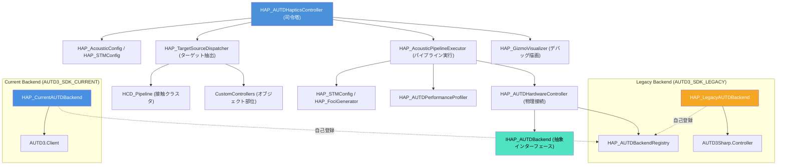

# AUTD3 SDK 新旧仕様比較・移行ドキュメント (v3.x/Legacy ➔ v0.14.1/Current) 仕様書

> 📂 **親ノード**: [Haptics.md](./Haptics.md) | 🏷️ **種類**: 🔧 SDK移行ガイド  
> [RealTimeOcclusion Wiki (ポータル)](./Wiki.md) に戻る

本ドキュメントでは、本システムでサポートしている AUTD3 SDK の**旧仕様 (Legacy SDK: `AUTD3Sharp` v3.x 系)** と**新仕様 (Current SDK: `autd3-sdk` v0.14.1 / Firmware v0.14.0 系)** における API、通信方式、設計思想、Inspector UI の違い、およびプロジェクトでの切り替え手順について解説します。

---

## 1. 概要

本プロジェクトは、旧 SDK 環境と新 SDK 環境の両方をいつでも実機で検証・動作させられるよう、**バックエンド分離アーキテクチャ**を採用しています。上位のコントローラーや焦点生成ロジックは一切の SDK 直接参照を持たず、抽象インターフェース `IHAP_AUTDBackend` を通じて操作されます。

### 主な特徴

* **バックエンド分離（プラグイン型自己登録）**: `Haptics.asmdef` は SDK 非依存であり、インストールされた SDK に応じて `Haptics.Backend.Legacy` または `Haptics.Backend.Current` が自動コンパイルされ、`HAP_AUTDBackendRegistry` に自己登録されます。
* **上位層からの `#if` 排除**: 焦点データは SDK 非依存の `HAP_FocusPoint` 構造体として生成・管理され、上位コードにコンパイルシンボル分岐を持ち込みません。
* **新旧リンク UI の自動切り替え**: `HAP_HardwareTabDrawer` は `USE_AUTD3_LEGACY` シンボルに応じて接続リンク選択肢を切り替えます。旧版では `TwinCAT` / `SOEM` / `Simulator` を表示し、新版 (v0.14.1) では TwinCAT を廃止して **`LAN (UDP/IPv6)` / `Simulator`** のみを表示します。
* **神クラス解消と責務分離**: `HAP_AUTDHapticsController` はライフサイクル司令塔に特化し、設定データ (`Config`)、ターゲット抽出 (`HAP_TargetSourceDispatcher`)、パイプライン実行 (`HAP_AcousticPipelineExecutor`)、Gizmo 描画 (`HAP_GizmoVisualizer`) に完全分離されています。
* **2段タブ式統合 Inspector**: `HAP_AUTDHapticsControllerEditor` 上で 6 つのタブ (`General`, `Hardware`, `Placement`, `Acoustics`, `Calibration`, `Debug`) を 2 段ツールバーで直感的に切り替え操作でき、個別コンポーネントの二重表示を防止しています。
* **ワンタップ自動切り替えスクリプト**: PowerShell スクリプト [switch-sdk.ps1](file:///c:/Users/hongo/Documents/tsutsumi/RealTimeOcclusion/switch-sdk.ps1) により、Package Manager 依存関係を一括で切り替えることができます。
* **UDP/IPv6 直接通信と非同期 Client 通信**: 新 SDK (v0.14.1) では TwinCAT ADS が不要となり、`TransportOption` による UDP/IPv6 リンクローカル通信および完全非同期 `async/await` 通信モデルを採用しています。

---

## 2. 設計思想・アーキテクチャ

### 2.1 ディレクトリ構成

```text
Assets/Features/Haptics/Scripts/
├── Haptics.asmdef                             # SDK非依存の共通アセンブリ
├── Backends/                                  # SDKバックエンド実装
│   ├── Current/
│   │   ├── Haptics.Backend.Current.asmdef     # defineConstraints: AUTD3_SDK_CURRENT (>= 0.14.0)
│   │   ├── HAP_CurrentAUTDBackend.cs          # autd3-sdk v0.14.1 ファサード
│   │   ├── HAP_CurrentConnectionSession.cs    # 接続・初期化・タイムアウト・切断セッション管理
│   │   ├── HAP_CurrentFociSender.cs           # 同期／非同期焦点送信・タイムアウト実行者
│   │   ├── HAP_CurrentHardwareConfigurator.cs # 変調・サイレンサー・ファン・温度設定コンフィグレーター
│   │   ├── HAP_CurrentHoloBuilder.cs          # 静的ホログラフィ (Naive/GSPAT) 専任ビルダー
│   │   ├── HAP_CurrentPatternBuilder.cs       # パターン構築・バッファ寿命統括オーケストレーター
│   │   ├── HAP_CurrentSendDiagnostics.cs      # スロットリング・送信統計集計・監視ログ
│   │   └── HAP_CurrentSTMBuilder.cs           # 時空間変調 STM (PatternStm/FociStm) 専任ビルダー
│   └── Legacy/
│       ├── Haptics.Backend.Legacy.asmdef      # defineConstraints: AUTD3_SDK_LEGACY
│       ├── HAP_LegacyAUTDBackend.cs           # AUTD3Sharp v3.x ライフサイクル・通信ファサード
│       ├── HAP_LegacyDatagramBuilder.cs       # Legacy データグラム/グループ構築専任ビルダー
│       └── HAP_LegacyHardwareConfigurator.cs  # Legacy 変調・サイレンサー・ファン・終了設定クラス
├── Config/                                    # 責務分離された純粋データ設定クラス (Pure C#)
│   ├── HAP_AcousticConfig.cs                  # 音響・ホログラフィ・指向性設定
│   ├── HAP_AUTDTransformConfig.cs             # AUTD 配置 JSON スナップショット構造
│   ├── HAP_DebugFocusConfig.cs                # 単焦点デバッグ照射・キャリブレーション設定
│   ├── HAP_ProfilingConfig.cs                 # プロファイラ・同期送信設定
│   ├── HAP_STMConfig.cs                       # STM変調モード・周波数設定
│   ├── HapticsIllusionTargetConfig.cs         # 触覚錯覚ターゲット設定
│   └── HapticsModulationOverride.cs           # ソース別変調オーバーライド設定
├── Core/                                      # 共通コア・インターフェース・主コントローラー
│   ├── HAP_AUTDBackendRegistry.cs             # バックエンド自己登録レジストリ
│   ├── HAP_AUTDEnums.cs                       # 共通列挙型 (HoloAlgorithm, STMMode, 振幅/出力方式等)
│   ├── HAP_AUTDHapticsController.cs           # 触覚パイプライン統括司令塔 (Orchestrator)
│   ├── HAP_BaseObjectHapticsController.cs     # オブジェクト部位触覚基底
│   ├── HAP_FocusPoint.cs                      # 焦点値型 (Vector3 Position, float Pascal)
│   └── IHAP_AUTDBackend.cs                    # バックエンド抽象インターフェース
├── CustomControllers/                         # オブジェクト固有の触覚コントローラー
│   ├── HAP_FoxBodyHapticsController.cs
│   ├── HAP_FoxFootHapticsController.cs
│   └── HapticsIllusion/
├── Debug/                                     # デバッグ・可視化・Gizmo・統一ログ連携
│   ├── Control/                               # HAP_AUTDDebugDisabler, HCD_AutdControllerBridge
│   ├── Diagnostics/                           # HAP_LogTriggers, HAP_ObjectHapticsDiagnostics
│   └── Gizmos/                                # HAP_GizmoVisualizer, HAP_SurfaceMappingGizmoDrawer, HAP_DebugFocusGizmoDrawer 等
├── Hardware/                                  # 物理デバイス通信・配置・TransformLoader
│   ├── AUTD3Device.cs                         # 単一アレイデバイス定義
│   ├── HAP_AUTDCalibration.cs                 # キャリブレーション機能
│   ├── HAP_AUTDDeviceGroup.cs                 # デバイスグループ構造
│   ├── HAP_AUTDHardwareController.cs          # ハードウェア接続・リンク・変調管理
│   ├── HAP_AUTDTransformLoader.cs             # デバイス配置JSON復元・プレハブ生成
│   ├── HAP_AUTDTransformSerializer.cs         # デバイス配置JSON保存・読込 I/O
│   └── HAP_DeviceOrientationHelper.cs         # SDK座標・照射方向整合ヘルパー
├── Processors/                                # アルゴリズム・データ変換・パイプライン実行者
│   ├── Foci/                                  # HAP_FociGenerator, HAP_ObjectFociGenerator, HAP_IllusionFociBuilder, HAP_DeviceGrouping
│   ├── Fox/                                   # HAP_FoxBoneHierarchyResolver, HAP_TargetContactEvaluator
│   ├── Pipeline/                              # HAP_AcousticPipelineExecutor, HAP_TargetSourceDispatcher, HAP_AUTDPerformanceProfiler, HAP_DebugFocusProcessor
│   └── Sources/                               # 焦点生成ソース (Centroid / Ellipse / Random)
└── Editor/                                    # エディタ拡張
    ├── HAP_AUTDHapticsControllerEditor.cs     # 2段タブ親インスペクター
    ├── Drawers/                               # Context, DebugFocus/ (永続化・操作), Tabs/ (6タブ専任Drawer)
    ├── SubComponents/                         # 個別コンポーネント用スリムエディタ (二重展開抑止)
    │   ├── HAP_AUTDHardwareControllerEditor.cs
    │   └── HAP_AUTDTransformLoaderEditor.cs
    ├── Calibration/                           # キャリブレーション専用エディタ＆Play状態永続化
    └── CustomControllers/                     # 各カスタムコントローラー専用エディタ＆セクション描画
```

### 2.2 クラス相関図



### 2.3 処理フロー

1. **初期化時**: シーン起動前（`BeforeSceneLoad`）に、有効なバックエンドが `HAP_AUTDBackendRegistry.RegisterBackend()` を呼び出して自己登録します。
2. **接続確立時**: `HAP_AUTDHardwareController.Awake()` が `HAP_AUTDBackendRegistry.CreateBackend()` からインスタンスを生成し、`OpenAsync()` でデバイス群へ接続します。
3. **ターゲット抽出時**: `HAP_AUTDHapticsController.Update()` 内で `HAP_TargetSourceDispatcher.CollectTargets()` が呼び出され、選択されたモード（`AutoHCD`, `ObjectTarget`, `Manual`）に応じて有効な接触対象を収集します。
4. **焦点計算と送信時**: `HAP_AcousticPipelineExecutor.Execute()` が `HAP_STMConfig`（楕円 STM / Precision ソース含む）および `HAP_FociGenerator` を用いて焦点を生成し、`hardwareController.Backend.SendFoci()` を経由してデバイスへ送信します。ターゲットが存在しない場合は `StopOutput()` (Null送信) が安全に実行されます。
5. **デバッグ描画時**: `HAP_AUTDHapticsController.OnDrawGizmos()` が `HAP_GizmoVisualizer.DrawControllerGizmos()` に委譲され、デバイス配置や指向性グルーピングが Scene ビュー上に視覚化されます。

---

## 3. セットアップ・使用方法

### 3.1 SDK環境の自動切り替え手順 (`switch-sdk.ps1`)

ルートディレクトリスクリプト [switch-sdk.ps1](file:///c:/Users/hongo/Documents/tsutsumi/RealTimeOcclusion/switch-sdk.ps1) を使用した切り替え手順です。

#### Step 1: PowerShell 起動と引数指定

Unity エディタを閉じた状態で、PowerShell から以下のコマンドを実行します。

```powershell
# 新 SDK (v0.14.1) へ切り替える場合
.\switch-sdk.ps1 new

# 旧 SDK (v3.x / Legacy) へ切り替える場合
.\switch-sdk.ps1 legacy

# 現在の適用状況を確認する場合
.\switch-sdk.ps1
```

#### Step 2: 変更の確認と Unity 起動

スクリプト実行により、`Packages/manifest.json` のパッケージ参照が自動更新され、不要なプロジェクトキャッシュがクリーンアップされます。Unity を起動すると、asmdef の `versionDefines` に基づいて対応するバックエンドのみが自動でコンパイルされます。また、`AUTD3_DefineSymbolSetup` により `USE_AUTD3_LEGACY` シンボルが自動更新され、Inspector のリンク種別 UI も自動で切り替わります。

#### Step 3: Windows ネットワーク・ファイアウォール設定 (v0.14.1 LAN 通信時)

新 SDK (v0.14.1) では TwinCAT ADS を使用せず、UDP over IPv6 リンクローカル（デバイス側ポート `44336`）で直接通信します。実機接続時は以下を確認してください。

1. AUTD3 を接続する NIC で **「インターネット プロトコル バージョン 6 (TCP/IPv6)」** を有効にします。
2. Windows Defender ファイアウォールで、リモートポート `44336` (UDP) からの受信を許可します（例: 管理者 PowerShell で `New-NetFirewallRule -DisplayName "AUTD3" -Direction Inbound -Protocol UDP -RemotePort 44336 -Action Allow`）。
3. 遅延ばらつきを抑えるため、NIC の詳細設定で「割り込みモデレーション (Interrupt Moderation)」を「無効」にすることを推奨します。

---

## 4. 仕様・パラメータ詳細

### 4.1 新旧 API 仕様比較表

| 項目 | 旧仕様 (v3.x / Legacy SDK) | 新仕様 (v0.14.1 / Current SDK) |
|---|---|---|
| **パッケージ名** | `com.shinolab.autd3` | `com.shinolab.autd3-sdk`, `com.shinolab.autd3-sdk.pattern.holo` |
| **名前空間** | `AUTD3Sharp` / `AUTD3Sharp.Gain.Holo` | `AUTD3` / `AUTD3.Holo` |
| **接続管理** | `Controller.OpenWithOption(...)` | `await Client.OpenAsync(geometry, new TransportOption { ... }, ct)` |
| **送信 API** | `controller.Send(datagram)` (同期ブロッキング) | `await client.SendAsync(command, ct)` / `await client.SendStreamingAsync(command, ct)` |
| **焦点型** | `(Point3, Amplitude)` | `AmplitudeTarget(Vector3, Amplitude)` |
| **出力バッファ** | `Pattern` / `GSPAT` 内部生成 | `geometry.PhaseBuffer()` + `geometry.IntensityBuffer()`（`IDisposable` 管理） |
| **ホログラフィ生成** | `new GSPAT(activeFoci, option)` | `Holo.Gspat(geometry, foci, wavelength, option, phases, intensities)` |
| **GSPAT 反復回数** | 固定 (100回) | `gspatRepeatCount` で可変制御可能（**デフォルト 20回** に最適化、CPU負荷を 1/5 に削減） |
| **単焦点 STM** | `new FociSTM(mergedFrames, freq)` | `new FociStm(samplingConfig, controlPointsList, new FociStmOption { ... })` |
| **多焦点 STM** | `new GainSTM(gains, freq)` | `new PatternStm(samplingConfig, phaseBuffers, intensityBuffers, new PatternStmOption { ... })` |
| **実機リンク** | `new AUTD3Sharp.Link.TwinCAT()` / `SOEM` | `TransportOption { Iface = Interface.Auto }` または `Interface.Name(...)` (`LAN`) |
| **Simulator Link** | `new AUTD3Sharp.Link.Remote(ipEndPoint, option)` (`127.0.0.1:8080`) | `TransportOption { Iface = Interface.Addr("[::1]:44336") }` |
| **Inspector リンク表示** | `TwinCAT` / `SOEM` / `Simulator` | `LAN (UDP/IPv6)` / `Simulator` |

---

## 5. デバッグ・留意事項

### 5.1 トラブルシューティング

* **多部位接触時の出力激減の防止**: 静的多焦点ホログラフィでは複数焦点へのエネルギー分散と位相干渉によって各焦点の音圧が急低下します。本システムはアクティブな部位の中から対象部位に対して単焦点集中照射（`Holo.Naive`）を行い、249 素子の全エネルギー（10,000 Pa）を維持して確実に知覚できるように設計されています。
* **空中停止・ジャンプからの出力復帰保証**: 空中判定（`SendNull` による全素子強度 0）後、着地した際に静的変調（`Modulation.Constant`）が FPGA で無効化されたままになるのを防ぐため、出力停止時に変調キャッシュを自動リセットし、再開時に確実に FPGA へ変調を再ロードします。また `_sendLock` 排他と `CancellationToken` タイムアウト制御により、Null コマンドと再開コマンドの順序逆転・競合を防止しています。
* **実機ファームウェアのバージョン不一致**: 実機ファームウェアを v0.14.0 へ更新した場合、旧 SDK (Legacy) や v0.9.0 からはプロトコル不整合により通信できません。実機運用時はファームウェアバージョン (v0.14.0) と SDK バージョン (`autd3-sdk` v0.14.1) が一致していることを確認してください。接続時には `ReadFirmwareVersionAsync` の結果がログに出力されます。
* **旧シーンの `linkType` 互換性**: 旧環境で保存されたシーンでは `linkType` が `TwinCAT` (`0`) または `SOEM` (`1`) としてシリアライズされています。新版 (`v0.14.1`) 環境で開いた場合、Inspector 上は `LAN (UDP/IPv6)` として扱われ、実行時も自動的に `LAN` (`Interface.Auto`) へフォールバックして接続します。必要に応じて Inspector の `LAN に更新` ボタンで保存値を更新できます。
* **UDP 送信タイムアウト制御 (`HAP_CurrentAUTDBackend`)**: v0.14.x の `Client` は内部バックグラウンドタスクやタイムアウトを持たない軽量ソケットとなったため、`HAP_CurrentAUTDBackend` 側で `CancellationTokenSource` によるコマンドタイムアウト制御と `_sendLock.Wait(0)` による先行フレームドロップ制御を行い、バッファ (`PhaseBuffer` / `IntensityBuffer`) を送信完了後に確実に `Dispose` します。
* **バックエンド未登録警告**: Unity コンソールに `No AUTD backend registered` が出力される場合は、Package Manager で `com.shinolab.autd3` または `com.shinolab.autd3-sdk` (v0.14.0 以上) のいずれかが正しくインポートされているか確認してください。
* **Inspector の設定二重表示**: 同一 GameObject に `HAP_AUTDHardwareController` や `HAP_AUTDTransformLoader` がアタッチされていても、専用のスリムエディタが自動適用されるため、設定が重複展開されることはありません。設定はすべて `HAP_AUTDHapticsController` の該当タブから操作します。

### 5.2 統制ログシステム (`AppLogManager`) との同期

動作ログには `[Haptics]` プレフィックスが付与されます。詳細については [Logging.md](./Logging.md) を参照してください。

| タグ名 | 対象コンポーネント / 役割 |
|---|---|
| `TagBackend` | デバイス接続・切断・バックエンド初期化・非同期送信ログ |
| `TagHardware` | 変調（Modulation）・サイレンサー・ファン設定の適用ログ |
| `TagTransformLoader` | デバイス配置 JSON 保存・読み込み・プレハブ生成ログ |
| `TagPerformanceProfiler` | パイプライン処理時間計測・スレッド同期ログ |
| `TagCalibration` | キャリブレーション信号照射・オフセット調整ログ |
