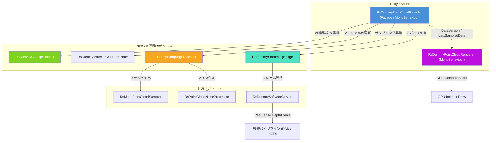

# ダミー点群生成・ノイズ付加システム (Dummy Point Cloud System) 仕様書

> 📂 **親ノード**: [Wiki.md](./Wiki.md) | 🏷️ **種類**: 🏗️ システム設計書  
> [RealTimeOcclusion Wiki (ポータル)](./Wiki.md) に戻る

本ドキュメントでは、Unity 上の 3D オブジェクト（`MeshFilter` または `SkinnedMeshRenderer`）から物理密度および色を指定して実測点群をリアルタイム生成し、さらにメッシュ法線方向のノイズや外れ値（Outliers）を付加する**ダミー点群生成・ノイズ付加システム**（`DPC`: Dummy Point Cloud System）の仕様・アーキテクチャ・使用方法について解説します。

---

## 1. 概要

本システムは、実機の RealSense カメラが接続されていない開発環境や定量評価実験環境において、RealSense 互換の点群ストリーム (`RsFrameProvider` / `RsDummySoftwareDevice`) を提供し、オクルージョン描画 (`PCD`) や触覚衝突判定 (`HCD`) などの後続パイプラインの動作検証を可能にします。

### 主な特徴

* **メッシュ面・頂点リアルタイムサンプリング**: 三角ポリゴン表面積に応じたランダムサンプリングにより、高精度なワールド座標 `Positions` とワールド法線 `Normals` を生成します。
* **物理ノイズ & 外れ値モデリング**: ガウス分布／一様分布に基づくメッシュ法線方向オフセットノイズ（発生割合 `noiseRatio` 制御対応）、および一定割合で離脱する外れ値（Outliers）を付与可能です。
* **動的オブジェクト切り替え & 自動追従**: `targetObjects` 内の GameObject のアクティブ／非アクティブ切替、Transform 移動、Renderer の有効無効、リスト参照の差し替えを毎フレーム自動検知し、即座に点群を再生成します。
* **全非アクティブ時の 0 点即時クリア**: 登録オブジェクトがすべて非アクティブ化された場合、前回の点群を残さず即座に 0 点にクリアして描画を停止します。
* **RealSense ソフトウェアデバイス互換**: RealSense SDK の `SoftwareDevice` 経由で `DepthFrame` ストリームを発行し、実機カメラと完全に同一のインターフェースを提供します。
* **責務分離アーキテクチャ**: Facade パターンを採用し、変更検知、マテリアル色同期、サンプリング処理、デバイス連携を Pure C# クラスに分離して高い保守性と拡張性を維持しています。
* **アロケーションフリー & GPU 高速描画**: 内部バッファ再利用による GC フリー設計と、Procedural Instancing（Indirect Draw）レンダラーによる「動いたら更新 (Dirty-based Update)」方式の超高速描画を実現しています。

---

## 2. 設計思想・アーキテクチャ

### 2.1 ディレクトリ構成

```text
Assets/Features/RealSense/
├── Scripts/
│   └── DummyMeasuredPointCloud/
│       ├── RsDummyPointCloudProvider.cs       # 統括 Facade プロバイダー (RsFrameProvider)
│       ├── RsDummyChangeTracker.cs            # ターゲット・Active・Transform変更検知 (Pure C#)
│       ├── RsDummyMaterialColorPresenter.cs   # MaterialPropertyBlock カラー同期 (Pure C#)
│       ├── RsDummySamplingProcessor.cs        # メッシュサンプリング & ノイズパイプライン (Pure C#)
│       ├── RsDummyStreamingBridge.cs          # RealSense SoftwareDevice ブリッジ (Pure C#)
│       ├── RsDummySoftwareDevice.cs           # 仮想 RealSense デバイス DepthFrame 生成
│       ├── RsDummyPointCloudRenderer.cs       # GPU Procedural Instancing (Indirect Draw) レンダラー
│       ├── RsMeshPointCloudSampler.cs         # メッシュ面・頂点点群サンプラー
│       ├── RsPointCloudNoiseProcessor.cs      # 法線ノイズ・外れ値計算
│       ├── RsDummyProcessingPipe.cs           # ダミーフレームパイプライン
│       └── DPC_LogTriggers.cs                 # AppLogManager 連動用ログトリガー
└── Editor/
    ├── RsDummyPointCloudProviderEditor.cs     # プロバイダー用カスタム Inspector
    ├── RsDummyPointCloudRendererEditor.cs     # レンダラー用カスタム Inspector
    └── RsDummyProcessingPipeEditor.cs         # パイプライン用カスタム Inspector
```

### 2.2 クラス相関図



### 2.3 処理フロー

```text
[毎フレームの Update 処理]
       │
       ▼
[RsDummyChangeTracker]
  ├─ targetObjects の要素参照変更・activeInHierarchy 切替を検知
  ├─ 各 Renderer の有効無効 (enabled) および増減を検知
  └─ Transform (移動・回転・スケール) およびカメラ視点の変更を検知
       │
       ├─ (変更あり / ダーティ時)
       ▼
[RsDummySamplingProcessor]
  ├─ 有効なオブジェクトのメッシュ面・頂点から指定密度で点群生成
  ├─ (有効オブジェクトが 0 件の場合は 0 点の空データを生成)
  └─ RsPointCloudNoiseProcessor で法線方向ノイズ / 外れ値を付加
       │
       ├──► [RsDummyStreamingBridge] ──► RealSense SoftwareDevice へ発行
       │
       └──► DataVersion インクリメント
              │
              ▼
[RsDummyPointCloudRenderer (LateUpdate)]
  ├─ DataVersion 変化を検知
  ├─ 点数 > 0 の場合: GPU ComputeBuffer 転送 & Indirect Draw 引数更新
  └─ 点数 = 0 の場合: Indirect Draw 引数を 0 にリセットして描画を即座に停止 (クリア)
```

---

## 3. セットアップ・使用方法

### 3.1 クイックスタート手順

#### Step 1: プロバイダーの配置

1. Scene 上の任意の GameObject に `RsDummyPointCloudProvider` をアタッチします。
2. 同一オブジェクトまたは描画用 GameObject に `RsDummyPointCloudRenderer` をアタッチします。

#### Step 2: ターゲットオブジェクトの登録

1. `Target 3D Objects` リストに、点群化させたい 3D オブジェクト（例: 手のモデル、立体モデル等）を登録します。
2. 複数のオブジェクトを登録しておき、Scene / Hierarchy 上でチェックボックス（`SetActive`）を切り替えることで、リアルタイムに対象を切り替える運用が可能です。

#### Step 3: 物理密度・カラー設定

| パラメータ名 | 型 | 既定値 | 説明 |
|---|---|---|---|
| `targetObjects` | `List<GameObject>` | `[]` | 点群化の対象となる 3D オブジェクトのリスト |
| `includeChildren` | `bool` | `true` | 子要素の全ての `MeshFilter` / `SkinnedMeshRenderer` を含めるか |
| `densityUnit` | `PointDensityUnit` | `PointsPerCm2` | 点群密度の指定単位 (`PointsPerCm2`, `PointsPerMm2`, `PointSpacingMm`, `TotalPointCount`) |
| `densityValue` | `float` | `1.0f` | 密度の数値設定 |
| `maxPointLimit` | `int` | `100000` | 生成する点群数の最大上限キャップ（過剰負荷防止） |
| `colorMode` | `PointColorMode` | `SolidColor` | 点群のカラー指定モード (`SolidColor`, `MaterialColor`, `VertexColor`) |
| `solidColor` | `Color` | 肌色系 | `SolidColor` モード時の点群およびオブジェクト表示色 |
| `applyColorToMaterialAndRenderer` | `bool` | `true` | オブジェクトのマテリアル色とレンダラー描画色を連動させるか |

#### Step 4: ノイズおよび外れ値の設定

1. `RsDummyPointCloudProvider` の **[Noise & Outliers Settings]** を開きます。
2. `Enable Noise` を `true` にし、`Noise Amount Mm` (ノイズ振幅, mm単位)、`Noise Ratio` (発生割合, 0.0〜1.0)、`Noise Type` (`Gaussian` / `Uniform`) を調整します。
3. `Enable Outliers` を `true` にし、`Outlier Ratio` (発生割合) および `Outlier Distance Mm` (離脱距離, mm単位) を調整します。

---

## 4. 仕様・パラメータ詳細

### 4.1 パラメータ仕様

#### A. ノイズ設定 (`RsPointCloudNoiseSettings`)

| パラメータ名 | 型 | 既定値 | 説明 |
|---|---|---|---|
| `updateMode` | `NoiseUpdateMode` | `Dynamic` | ノイズの更新モード (`Dynamic`: フレームごと動的 / `Static`: 初回パターン固定) |
| `enableNoise` | `bool` | `false` | メッシュ法線方向へのノイズ移動を有効化 |
| `noiseAmountMm` | `float` | `2.0f` | 法線方向への移動ノイズ量 (mm) |
| `noiseRatio` | `float` | `1.0f` | 全点群に対するノイズの発生割合 (0.01 = 1%, 1.0 = 100%) |
| `noiseType` | `NoiseDistributionType` | `Gaussian` | ノイズの確率分布 (`Gaussian`: 正規分布 / `Uniform`: 一様分布) |
| `enableOutliers` | `bool` | `false` | 外れ値（飛び値）の生成を有効化 |
| `outlierRatio` | `float` | `0.02f` | 全点群に対する外れ値の発生割合 (0.01 = 1%) |
| `outlierDistanceMm` | `float` | `50.0f` | 外れ値の移動離脱距離 (mm) |
| `outlierUseRandomDirection` | `bool` | `false` | `true`: 全方向ランダム / `false`: メッシュ法線方向に離脱 |

#### B. 外部連携 API (`RsDummyPointCloudProvider`)

| メソッド名 | 引数 | 説明 |
|---|---|---|
| `SetTargetObject` | `(GameObject target, bool forceUpdateNow = true)` | 単一のターゲットオブジェクトを設定し、必要に応じて即時サンプリング更新します |
| `SetTargetObjects` | `(IEnumerable<GameObject> targets, bool forceUpdateNow = true)` | 複数のターゲットオブジェクトを設定し、必要に応じて即時サンプリング更新します |
| `ForceUpdateSampling` | なし | 次フレームを待たずに即座に再サンプリングを行い、レンダラーの GPU バッファまで同期反映します |
| `SetDirty` | なし | ダーティフラグを立て、次フレームの `Update` で強制的に再計算を行わせます |
| `UpdateMaterialAndRendererColors` | なし | ターゲットオブジェクト群のマテリアルカラーを同期・更新します |

### 4.2 数式モデル・理論的背景

<details>
<summary><b>📐 法線方向ノイズおよび外れ値生成の数理モデル（クリックで展開）</b></summary>

#### A. 法線オフセットノイズ計算式

メッシュ面上の点 $\mathbf{p}_i$ に対し、発生確率 $P_{\text{noise}} = \text{noiseRatio}$ の条件を満たす場合にワールド単位法線ベクトル $\mathbf{n}_i$ 方向へ付与される移動後座標 $\mathbf{p}'_i$ は次式で表されます。

$$
\mathbf{p}'_i = \begin{cases}
\mathbf{p}_i + \left( \delta_i \cdot \mathbf{n}_i \right) & (\text{Random}(0, 1) < \text{noiseRatio}) \\
\mathbf{p}_i & (\text{otherwise})
\end{cases}
$$

ここで、ガウス分布ノイズ $\delta_i \sim \mathcal{N}(0, \sigma^2)$ の場合、Box-Muller 変換により 2 つの一様乱数 $u_1, u_2 \sim U(0, 1)$ から次のように生成されます。

$$
\delta_i = A_{\text{noise}} \cdot \sqrt{-2 \ln u_1} \cdot \cos(2\pi u_2)
$$

| 記号 | 説明 | 単位 / 型 |
|---|---|---|
| $\mathbf{p}_i$ | サンプリング点の初期ワールド座標 | `Vector3` |
| $\mathbf{n}_i$ | メッシュのワールド単位法線ベクトル | `Vector3` |
| $A_{\text{noise}}$ | ノイズ振幅 (`noiseAmountMm`) | $\mathrm{mm}$ (`float`) |
| $P_{\text{noise}}$ | ノイズ付与発生割合 (`noiseRatio`) | スカラー (`float`) |
| $\delta_i$ | 法線方向移動スカラー量 | $\mathrm{mm}$ (`float`) |

#### B. 外れ値 (Outlier) 生成モデル

確率 $P_{\text{outlier}} = \text{outlierRatio}$ で生成される外れ値座標 $\mathbf{p}_{\text{outlier}}$ は以下の処理で決定されます。

$$
\mathbf{p}_{\text{outlier}} = \begin{cases}
\mathbf{p}_i + D_{\text{outlier}} \cdot \mathbf{d}_{\text{random}} & (\text{outlierUseRandomDirection} = \text{true}) \\
\mathbf{p}_i + D_{\text{outlier}} \cdot \mathbf{n}_i & (\text{outlierUseRandomDirection} = \text{false})
\end{cases}
$$

| 記号 | 説明 | 単位 / 型 |
|---|---|---|
| $D_{\text{outlier}}$ | 外れ値離脱距離 (`outlierDistanceMm`) | $\mathrm{mm}$ (`float`) |
| $\mathbf{d}_{\text{random}}$ | 単位球面上の全方向ランダムベクトル | `Vector3` |

</details>

---

## 5. デバッグ・留意事項

### 5.1 パフォーマンスおよび設計上の留意事項

* **遅延初期化（Lazy Initialization）による安全性保証**:
  Unity では `MonoBehaviour` のコンストラクタ内で `new Mesh()` 等の `UnityEngine.Object` 生成が禁止されているため、すべての内部責務クラス（`ChangeTracker`, `SamplingProcessor`, `StreamingBridge`, `MaterialColorPresenter`）はプロパティアクセス時の遅延初期化を採用しています。これによりエディタインスペクター（`OnValidate`）や起動時の例外を完全に防止しています。
* **アロケーションフリー設計**:
  `RsPointCloudNoiseProcessor` および `RsMeshPointCloudSampler` は内部配列バッファを再利用するため、毎フレームのサンプリング・ノイズ処理実行時に不要な GC Alloc が発生しません。
* **静止時 0ms 描画 & 0 点時完全停止**:
  `RsDummyPointCloudRenderer` は `DataVersion` を保持し、オブジェクトに移動がない静止時は GPU への `SetData` を完全にスキップします。また、全オブジェクトが非アクティブ化された際は Indirect Draw 引数を 0 にリセットして描画処理を完全に停止します。

### 5.2 統制ログシステム (AppLogManager) との同期

本モジュールの動作ログは `AppLogManager` の **`[DPC (Dummy Point Cloud)]`** グループで一元管理されます。

| サブトリガー | 説明 |
|---|---|
| `DPC_Provider` | 点群ストリームの開始・停止およびサンプリング更新ログを出力します |
| `DPC_Renderer` | GPU ComputeBuffer への転送および描画実行ログを出力します |
| `DPC_NoiseProcessor` | ノイズおよび外れ値の適用結果（処理点数、パラメータ状態）を出力します |
| `DPC_ProcessingPipe` | ダミーフレームパイプラインの動作状態ログを出力します |
| `DPC_SoftwareDevice` | ソフトウェアデバイスの初期化およびデータ供給ログを出力します |

詳細なログ仕様については [Logging.md](./Logging.md) を参照してください。
