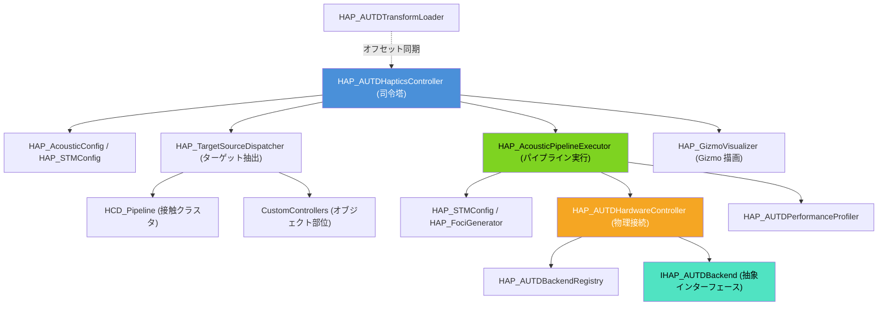

# 触覚フィードバック統合システム (Haptics System) 仕様書

> 📂 **親ノード**: [Wiki.md](./Wiki.md) | 🏷️ **種類**: 🏗️ システム設計書  
> [RealTimeOcclusion Wiki (ポータル)](./Wiki.md) に戻る  
> 📎 **関連ドキュメント**: [AUTD3_SDK_Transition.md](./AUTD3_SDK_Transition.md) | [HowToUseHaptics.md](./HowToUseHaptics.md) | [HapticsAlgorithmComparison.md](./HapticsAlgorithmComparison.md)

本ドキュメントでは、空中超音波フェーズドアレイ (AUTD3) を用いてリアルタイムに触覚刺激（力覚・触覚フィードバック）を提示する「触覚フィードバック統合システム (`HAP`: Haptics System)」の設計思想、モジュール構成、使用手順、パラメータ詳細およびデバッグ方法について解説します。

---

## 1. 概要

本システムは、`HCD_Pipeline` (接触判定システム) によって検出された 3D 接触点群・クラスタ情報、または仮想オブジェクト部位の接触判定を受け取り、AUTD3 超音波アレイを制御して空中焦点 (Focus Point) または時空間変調パターン (STM: Spatio-Temporal Modulation) をリアルタイムに提示する基盤です。

### 主な特徴

* **マルチアレイデバイス統括**: 複数の AUTD3 フェーズドアレイの空間配置（トランスフォーム）を一括管理し、位相・振幅パターンを最適計算します。
* **プラグイン型バックエンド分離**: AUTD3 SDK v3.x (Legacy) および v0.14.1 (Current / Firmware v0.14.0 対応) の両方に対応し、`switch-sdk.ps1` によりシームレスに切り替え動作が可能です。
* **責務分離と神クラス解消**: 主コントローラー [`HAP_AUTDHapticsController`](file:///c:/Users/hongo/Documents/tsutsumi/RealTimeOcclusion/Assets/Features/Haptics/Scripts/Core/HAP_AUTDHapticsController.cs) はライフサイクル統括に特化し、設定データ ([`HAP_AcousticConfig`](file:///c:/Users/hongo/Documents/tsutsumi/RealTimeOcclusion/Assets/Features/Haptics/Scripts/Config/HAP_AcousticConfig.cs) 等)、ターゲット抽出 ([`HAP_TargetSourceDispatcher`](file:///c:/Users/hongo/Documents/tsutsumi/RealTimeOcclusion/Assets/Features/Haptics/Scripts/Processors/HAP_TargetSourceDispatcher.cs))、パイプライン実行 ([`HAP_AcousticPipelineExecutor`](file:///c:/Users/hongo/Documents/tsutsumi/RealTimeOcclusion/Assets/Features/Haptics/Scripts/Processors/HAP_AcousticPipelineExecutor.cs)) に完全分離されています。
* **2段タブ式統合 Inspector**: 1画面から通信設定、配置管理、音響、STM、焦点設定、プロファイリングを統合管理できます。また、個別コンポーネント用スリムエディタにより、インスペクター上での設定の二重展開を防止しています。
* **指向性グルーピング照射**: 接触面の法線ベクトルとデバイスの向きを比較し、最適なデバイスからのみ超音波を照射する高効率照射機能を備えています。

---

## 2. 設計思想・アーキテクチャ

### 2.1 生成ファイル・ディレクトリ構成

```text
Assets/Features/Haptics/Scripts/
├── Haptics.asmdef                             # SDK非依存の共通アセンブリ
├── Backends/                                  # 新旧SDKバックエンド実装
│   ├── Current/                               # autd3-sdk v0.14.1 実装 (Backend, ConnectionSession, HardwareConfigurator, HoloBuilder, STMBuilder, PatternBuilder, FociSender, SendDiagnostics)
│   └── Legacy/                                # AUTD3Sharp v3.x 実装 (HAP_LegacyAUTDBackend, HAP_LegacyDatagramBuilder, HAP_LegacyHardwareConfigurator)
├── Config/                                    # Pure C# 設定・スナップショットクラス
│   ├── HAP_AcousticConfig.cs                  # 音響・ホログラフィ設定
│   ├── HAP_AUTDTransformConfig.cs             # AUTD配置JSONスナップショット設定
│   ├── HAP_DebugFocusConfig.cs                # 単焦点デバッグ照射・キャリブレーション設定
│   ├── HAP_ProfilingConfig.cs                 # 処理時間計測設定
│   ├── HAP_STMConfig.cs                       # STM変調設定
│   ├── HapticsIllusionTargetConfig.cs         # 触覚錯覚用独立焦点設定
│   └── HapticsModulationOverride.cs           # ソース別変調オーバーライド設定
├── Core/                                      # 共通コア・インターフェース
│   ├── HAP_AUTDBackendRegistry.cs             # バックエンド登録レジストリ
│   ├── HAP_AUTDEnums.cs                       # 共通列挙型定義
│   ├── HAP_AUTDHapticsController.cs           # 触覚パイプライン統括司令塔
│   ├── HAP_BaseObjectHapticsController.cs     # オブジェクト部位触覚基底 (神クラス解消済み)
│   ├── HAP_FocusPoint.cs                      # 焦点構造体
│   └── IHAP_AUTDBackend.cs                    # バックエンド抽象インターフェース
├── CustomControllers/                         # 個別オブジェクト用触覚コントローラー
│   ├── HAP_FoxBodyHapticsController.cs        # 狐全身8部位の触覚ターゲット管理
│   ├── HAP_FoxFootHapticsController.cs        # 狐4足・尻尾の足部触覚管理
│   └── HapticsIllusion/                       # 触覚錯覚カスタムコントローラー群
├── Debug/                                     # デバッグ・Gizmo・統一ログ（機能別サブフォルダ分離）
│   ├── Control/                               # 強制ミュート・HCD連携ブリッジ
│   ├── Diagnostics/                           # AppLogManager 登録・診断レポート出力
│   └── Gizmos/                                # デバイス枠線・表面OBB・単焦点・部位別・錯覚 Gizmo 描画
├── Hardware/                                  # 物理デバイス通信・配置
│   ├── AUTD3Device.cs                         # 単一アレイデバイス定義
│   ├── HAP_AUTDCalibration.cs                 # キャリブレーションコンポーネント
│   ├── HAP_AUTDDeviceGroup.cs                 # デバイスグループ定義
│   ├── HAP_AUTDHardwareController.cs          # 物理通信・リンク管理
│   ├── HAP_AUTDTransformLoader.cs             # デバイス配置JSON復元・生成オーケストレーター
│   ├── HAP_AUTDTransformSerializer.cs         # デバイス配置JSONファイル I/O ヘルパー
│   └── HAP_DeviceOrientationHelper.cs         # 物理照射面・SDK座標系整合ヘルパー
├── Processors/                                # アルゴリズム・パイプライン実行者（機能別サブフォルダ分離）
│   ├── Foci/                                  # 焦点生成・グルーピング・HCD/オブジェクト/錯覚ビルダー
│   ├── Fox/                                   # Foxボーン階層自動検出・接地/手接触評価
│   ├── Pipeline/                              # 実行パイプライン・ディスパッチ・単焦点処理・計測
│   └── Sources/                               # 焦点生成ソース (Centroid / Ellipse / Random)
└── Editor/                                    # エディタ拡張
    ├── HAP_AUTDHapticsControllerEditor.cs     # 2段タブ親インスペクター
    ├── Drawers/                               # 共通Context・DebugFocus/・Tabs/ (6タブ専任Drawer)
    ├── SubComponents/                         # 個別コンポーネント用スリムエディタ
    ├── Calibration/                           # キャリブレーション用エディタ＆状態永続化
    └── CustomControllers/                     # カスタムコントローラー用エディタ＆セクション描画
```

### 2.2 クラス相関図



### 2.3 処理フロー

```text
[HCD_Pipeline / CustomController] (接触クラスタ & オブジェクト部位ターゲット)
       │
       ▼
[HAP_TargetSourceDispatcher] (モード判定 & アクティブターゲット抽出)
       │
       ▼
[HAP_AcousticPipelineExecutor] (焦点位置・強度計算 & GSPAT/Naive ホログラフィ構築)
       │
       ▼
[HAP_AUTDHardwareController.Backend] (IHAP_AUTDBackend 経由の非同期/同期送信)
       │
       ▼
[AUTD3 超音波アレイ実機 / Simulator]
```

### 2.4 物理配置と照射面座標整合仕様 (`HAP_DeviceOrientationHelper`)

Unity 上の `AUTD3.prefab` 構造（トランスデューサ `(0,0)` を原点としてローカル `+X/+Y` 方向に振動子配列を展開し、ローカル `-Z` 方向へ超音波を照射する定義）と各 SDK バックエンドの座標変換規約を整合させるため、[`HAP_DeviceOrientationHelper`](file:///c:/Users/hongo/Documents/tsutsumi/RealTimeOcclusion/Assets/Features/Haptics/Scripts/Hardware/HAP_DeviceOrientationHelper.cs) で回転・方向取得を管理しています。

* **新版 SDK (`autd3-sdk` v0.14.1 / Current SDK)**:
  `Coords.cs` が Unity 左手系から `Autd3` 右手系へ `Z` 軸反転して変換するため、`GetCurrentSdkRotation` により Unity の `transform.rotation` をそのまま（Y 軸 180° 反転なしで）渡します。これにより `Autd3` の振動子配列（`+X`/`+Y`）および照射方向（`AxialDirection = -transform.forward`）がプレハブと 1 対 1 で一致します。
* **旧版 SDK (`AUTD3Sharp` v3.x / Legacy SDK) および Unity 側幾何判定**:
  旧版 SDK はローカル `+Z` 照射基準であるため、`GetAdjustedRotation`（`rotation * Quaternion.Euler(0f, 180f, 0f)`）を適用します。また、指向性グルーピング (`HAP_DeviceGrouping`) や Gizmo 描画での照射ベクトル取得は `GetAdjustedForward`（`-transform.forward` 相当）を使用します。
* **物理照射ベクトルの整合性**:  
  上記仕様により、床面 4 台（Device 2, 3, 4, 5）および斜めスタンド 4 台（Device 0, 1, 6, 7）のすべての振動子位置と位相計算が、シーン上の配置と正確に一致します。

---

## 3. セットアップ・使用方法

### 3.1 クイックスタート手順

#### Step 1: シーンオブジェクトの配置

1. シーン内の管理オブジェクト（例: `GenaralAUTD3Controller`）に [`HAP_AUTDHapticsController`](file:///c:/Users/hongo/Documents/tsutsumi/RealTimeOcclusion/Assets/Features/Haptics/Scripts/Core/HAP_AUTDHapticsController.cs) をアタッチします。
2. 依存コンポーネント（[`HAP_AUTDHardwareController`](file:///c:/Users/hongo/Documents/tsutsumi/RealTimeOcclusion/Assets/Features/Haptics/Scripts/Hardware/HAP_AUTDHardwareController.cs), [`HAP_AUTDTransformLoader`](file:///c:/Users/hongo/Documents/tsutsumi/RealTimeOcclusion/Assets/Features/Haptics/Scripts/Hardware/HAP_AUTDTransformLoader.cs)）は `Awake()` 時に自動検出されます。同一オブジェクトにアタッチされていても、専用のスリムエディタによりインスペクターは自動的にスッキリ整理されます。

#### Step 2: 2段タブ式 Inspector でのパラメータ設定

`HAP_AUTDHapticsController` の Inspector 上部にある 2 段ツールバーから各タブを切り替えて設定を行います：

```
[ ⚙️ General ]   [ 📡 Hardware ]     [ 📐 Placement ]
[ 🔊 Acoustics ] [ 🎯 Calibration ]  [ ⏱️ Debug ]
```

* **⚙️ General**: 動作モード (`AutoHCD`: 手指接触クラスタ連動 / `ObjectTarget`: 仮想オブジェクト部位 / `Manual`: 手動API) を選択します。
* **📡 Hardware**: 通信リンク種別（新版: `LAN (UDP/IPv6)`, `Simulator` / 旧版: `TwinCAT`, `SOEM`, `Simulator`）、変調周波数、サイレンサーを設定します。
* **📐 Placement**: デバイス配置 JSON の保存/復元、プレハブ自動生成、全体焦点オフセットを調整します。
* **🔊 Acoustics**: ホログラフィアルゴリズム (`GSPAT`, `Naive`)、照射強度 (`focusIntensityPascal`: デフォルト 10,000 Pa)、GSPAT 反復回数、指向性グルーピング、STM（AutoHCD 用楕円 STM / Precision ソース含む）を設定します。
* **🎯 Calibration**: 単焦点デバッグ照射・空間キャリブレーション（任意座標・Transform 追従・1mm/10mm 微調整・出力/変調オーバーライド・差分 Offset 自動補正）を制御します。
* **⏱️ Debug**: Scene ビューの Gizmo 表示 ON/OFF、特定デバイスの強制ミュート、処理時間プロファイラー、および `AppLogManager` 連携を制御します。

#### Step 3: 実行

Play モードに入ると、選択されたバックエンド経由で AUTD3 への通信が確立され、接触検出時に即座に超音波焦点が出力されます。

---

## 4. 仕様・パラメータ詳細

### 4.1 主要パラメータ一覧

| パラメータ名 | 所属設定クラス | 既定値 | 説明 |
|---|---|---|---|
| `sourceMode` | コントローラー本体 | `AutoHCD` | 触覚ターゲットのデータソース (`AutoHCD`, `ObjectTarget`, `Manual`) |
| `focusIntensityPascal` | `HAP_AcousticConfig` | `10000.0f` | 超音波照射強度 (Pascal)。最大約 10,000 Pa |
| `holoAlgorithm` | `HAP_AcousticConfig` | `GSPAT` | ホログラフィ計算アルゴリズム (`GSPAT`, `Naive`) |
| `gspatRepeatCount` | `HAP_AcousticConfig` | `20` | GSPAT 反復回数 (1〜100)。20 回で高品質かつ低負荷を実現 |
| `enableDirectionalGrouping` | `HAP_AcousticConfig` | `false` | 面の法線とデバイスの向きを比較した最適照射の有効化 |
| `stmMode` | `HAP_STMConfig` | `FociSTM` | 時空間変調モード (`FociSTM`: 単焦点, `GainSTM`: 多焦点) |
| `stmFrequency` | `HAP_STMConfig` | `150.0f` | STM 再生周波数 (Hz) |
| `enableProfiling` | `HAP_ProfilingConfig` | `false` | パイプライン処理時間の計測有効化 |
| `synchronousSend` | `HAP_ProfilingConfig` | `false` | メインスレッドでの完全同期送信フラグ |

---

## 5. デバッグ・留意事項

### 5.1 トラブルシューティング

* **超音波が出力されない・極端に弱い場合**:
  1. `HAP_AUTDHapticsController` Inspector 上部の PlayMode ステータスバナーで `● Hardware Connected` と表示されているか確認してください。
  2. `bypassHaptics` が `false` であることを確認してください。
  3. `sourceMode` が `AutoHCD` の場合、`HCD_Pipeline` で手指の接触クラスタが正常に検出されているか確認してください。
  4. **変調モードの確認**: `HAP_AUTDHardwareController` の `Modulation Mode` が `Sine`（周波数 150Hz）に設定されているか確認してください。`Static`（直流）に設定されていると、皮膚の機械受容器が順応して触覚を感じにくくなります。
  5. **多焦点による減衰の防止**: 複数部位が存在する場合、多焦点分散による音圧低下を防ぐため、システムはアクティブな部位へ単焦点集中照射（`Holo.Naive`）を行い、最大音圧（10,000 Pa）を維持します。
  6. **ジャンプ・空中停止からの出力復帰保証**: 接地判定（`disableWhenInAir`）による空中判定で出力停止（`SendNull`）が行われた後、着地時に変調キャッシュを自動リセットし、先行送信タスクの排他待機を経て `Modulation.Constant` / `Sine` が FPGA へ確実に再適用されます。
* **Inspector の設定二重表示が発生しない理由**:
  `HAP_AUTDHardwareControllerEditor` 等のスリムエディタが個別コンポーネントの Default Inspector 展開を抑制し、`HAP_AUTDHapticsController` のタブ UI に一本化しているためです。

### 5.2 統制ログシステム (`AppLogManager`) との同期

動作ログには `[Haptics]` プレフィックスが付与されます。詳細については [Logging.md](./Logging.md) を参照してください。

| タグ名 | 対象コンポーネント / 役割 |
|---|---|
| `TagBackend` | デバイス接続・切断・バックエンド初期化・非同期送信ログ |
| `TagHardware` | 変調（Modulation）・サイレンサー・ファン設定の適用ログ |
| `TagTransformLoader` | デバイス配置 JSON 保存・読み込み・プレハブ生成ログ |
| `TagPerformanceProfiler` | パイプライン処理時間計測・スレッド同期ログ |
| `TagCalibration` | キャリブレーション信号照射・オフセット調整ログ |
