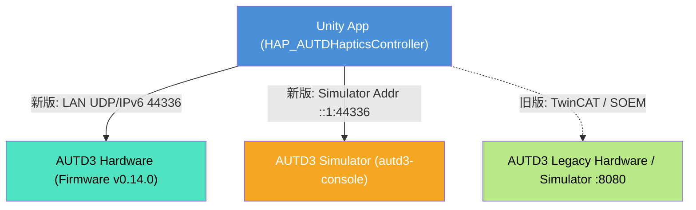

# 触覚機能セットアップ・使用手順ガイド 仕様書

> 📂 **親ノード**: [Haptics.md](./Haptics.md) | 🏷️ **種類**: 📖 使用手順ガイド  
> [RealTimeOcclusion Wiki (ポータル)](./Wiki.md) に戻る  
> 📎 **関連ドキュメント**: [AUTD3_SDK_Transition.md](./AUTD3_SDK_Transition.md) | [Logging.md](./Logging.md)

本ドキュメントでは、本システムで空中超音波触覚ディスプレイ (AUTD3) を導入・接続し、触覚フィードバックを提示するための環境構築手順、2段タブ式 Inspector パラメータ設定、および API 呼び出し手順について解説します。

---

## 1. 概要

本ガイドは、開発者や実験担当者が実機 AUTD3 デバイスまたは AUTD3 Simulator 環境において、短時間で触覚システムを立ち上げ、直感的に操作・検証するためのステップ・バイ・ステップのマニュアルです。

---

## 2. 設計思想・アーキテクチャ

### 2.1 関連コンポーネント構成

```text
Assets/Features/Haptics/Scripts/
├── Core/
│   └── HAP_AUTDHapticsController.cs   # 触覚パイプライン統括司令塔
├── Hardware/
│   ├── HAP_AUTDHardwareController.cs  # 通信リンク・物理接続管理
│   ├── HAP_AUTDTransformLoader.cs     # 配置JSON保存/読込・プレハブ生成
│   ├── HAP_DeviceOrientationHelper.cs # 物理照射面ローカル反転整合ヘルパー
│   └── AUTD3Device.cs                 # 単一アレイデバイス定義
├── Processors/
│   ├── HAP_TargetSourceDispatcher.cs  # 触覚ターゲット抽出
│   └── HAP_AcousticPipelineExecutor.cs# 焦点生成〜バックエンド送信実行
└── Editor/
    ├── HAP_AUTDHapticsControllerEditor.cs # 2段タブ統合エディタ
    └── SubComponents/                 # 個別コンポーネント用スリムエディタ
```

### 2.2 システム接続相関図



---

## 3. セットアップ・使用方法

### 3.1 クイックスタート手順

#### Step 1: SDK バージョンの確認・切り替え

プロジェクトのルートディレクトリで PowerShell を起動し、利用環境に応じた SDK バックエンドを選択します（詳細は [AUTD3_SDK_Transition.md](./AUTD3_SDK_Transition.md) を参照）。

```powershell
# 新 SDK (v0.14.1) の場合
.\switch-sdk.ps1 new

# 旧 SDK (v3.x / Legacy) の場合
.\switch-sdk.ps1 legacy
```

#### Step 2: シーンオブジェクトの配置

1. シーン内の管理オブジェクト（例: `GenaralAUTD3Controller`）に [`HAP_AUTDHapticsController`](file:///c:/Users/hongo/Documents/tsutsumi/RealTimeOcclusion/Assets/Features/Haptics/Scripts/Core/HAP_AUTDHapticsController.cs) をアタッチします。
2. 同一オブジェクトまたは子オブジェクトに [`HAP_AUTDHardwareController`](file:///c:/Users/hongo/Documents/tsutsumi/RealTimeOcclusion/Assets/Features/Haptics/Scripts/Hardware/HAP_AUTDHardwareController.cs) および [`HAP_AUTDTransformLoader`](file:///c:/Users/hongo/Documents/tsutsumi/RealTimeOcclusion/Assets/Features/Haptics/Scripts/Hardware/HAP_AUTDTransformLoader.cs) をアタッチします（未アタッチ時でも `Awake()` 時に自動追加・検出されます）。
3. 個別コンポーネントには専用スリムエディタが適用されているため、Inspector 下部に設定が重複展開されることはありません。

#### Step 3: 2段タブ式 Inspector でのパラメータ設定

`HAP_AUTDHapticsController` の Inspector 上部にある 2 段ツールバーから各タブを切り替えて設定を行います：

```
[ ⚙️ General ]   [ 📡 Hardware ]     [ 📐 Placement ]
[ 🔊 Acoustics ] [ 🎯 Calibration ]  [ ⏱️ Debug ]
```

1. **「📡 Hardware」タブ**:
   * 通信リンク種別 (`linkType`) を環境に合わせて選択します（新版 SDK: `LAN (UDP/IPv6)` / `Simulator`、旧版 SDK: `TwinCAT` / `SOEM` / `Simulator`）。
   * 変調周波数 (`sineFrequency`: デフォルト 150 Hz) を設定します。
2. **「📐 Placement」タブ**:
   * `デバイス GameObject を生成` ボタンを押下して、必要な数の `Autd0`, `Autd1`... プレハブをシーンに展開します。
   * 配置調整後、`シーン配置を JSON に保存` ボタンを押下することで位置・回転を保存できます。
   * デバイスの物理照射面と SDK 座標系の整合は [`HAP_DeviceOrientationHelper`](file:///c:/Users/hongo/Documents/tsutsumi/RealTimeOcclusion/Assets/Features/Haptics/Scripts/Hardware/HAP_DeviceOrientationHelper.cs) で自動処理されます（新版 SDK `v0.14.1` は Unity ローカル `-Z` 照射のまま `GetCurrentSdkRotation` を使用し、旧版 SDK のみローカル Y 軸 180° 反転を適用します）。
3. **「⚙️ General」タブ**:
   * `sourceMode` を `AutoHCD`（手指接触検出）または `ObjectTarget`（仮想オブジェクト部位）に設定します。
4. **「🔊 Acoustics」タブ**:
   * 出力強度 (`focusIntensityPascal`: 既定値 10,000 Pa)、ホログラフィアルゴリズム (`GSPAT`)、および STM 設定（AutoHCD 時の楕円 STM / `Precision` ソース含む）を設定します。
5. **「🎯 Calibration」タブ（単焦点デバッグ照射・空間キャリブレーション）**:
   * `🎯 単焦点テスト照射を開始` を押下すると、通常出力（`AutoHCD` / `ObjectTarget`）を上書きし、任意座標へ単焦点（`HoloAlgorithm.Naive`）を連続照射します。
   * 既定では `最大出力 (Duty 100%) で駆動` (`maximizeDuty = true`) および `照射中は Sine 変調 (AM) を強制` (`forceSineModulation = true`, `150 Hz`) が有効になっており、本体設定が `Static`（直流）でも静止単焦点を知覚しやすい最大出力で照射します（照射終了・停止時に元の変調設定へ自動復帰します）。
   * `Target Transform`（または `Focus Position` と `±1mm / ±10mm` 微調整ボタン、Scene ビュー上の Move ハンドル）で焦点位置を移動し、`正解位置 Transform` を指定して `Offset を自動補正` することで、`HAP_AUTDTransformLoader.offset` へ差分を反映できます（Play 中に編集した座標・オフセットは停止後も自動保持されます）。
6. **「⏱️ Debug」タブ（Gizmos・デバイスミュート・計測）**:
   * `Scene ビュー可視化 (Gizmos)` でデバイス枠線・キャリブレーション焦点 Gizmo の表示 ON/OFF を切り替えられます。
   * `特定デバイスの強制停止 (Debug Mute)` で対象デバイスを個別に ON/OFF でき、`パフォーマンス計測 & 統合ログ` からプロファイラや `AppLogManager` へアクセスできます。

#### Step 4: C# スクリプトからの手動操作例 (Manual Mode)

```csharp
using UnityEngine;

public class HapticsManualTriggerExample : MonoBehaviour
{
    public HAP_AUTDHapticsController hapticsController;

    void Update()
    {
        // キー入力で触覚照射のバイパス・再開をトグル
        if (Input.GetKeyDown(KeyCode.Space))
        {
            hapticsController.bypassHaptics = !hapticsController.bypassHaptics;
            Debug.Log($"Bypass Haptics: {hapticsController.bypassHaptics}");
        }

        // 音圧強度やSTM周波数を動的変更
        if (Input.GetKeyDown(KeyCode.UpArrow))
        {
            hapticsController.focusIntensityPascal = Mathf.Min(10000f, hapticsController.focusIntensityPascal + 1000f);
        }
    }
}
```

---

## 4. 仕様・パラメータ詳細

### 4.1 通信仕様・ネットワーク設定

* **新版 SDK (`autd3-sdk` v0.14.1 / Firmware v0.14.0)**:
  * **実機 LAN 接続**: UDP over IPv6 リンクローカル（デバイス側ポート `44336`）で通信します。TwinCAT ADS や WinPcap/Npcap は不要です。接続先 NIC で IPv6 を有効にし、送信元 UDP ポート `44336` の受信をファイアウォールで許可してください。
  * **Simulator 接続**: `autd3-console` 同梱 Simulator の既定アドレス `[::1]:44336` へ UDP 接続します。
* **旧版 SDK (`AUTD3Sharp` v3.x)**:
  * **TwinCAT / SOEM 接続**: TwinCAT ADS または WinPcap/Npcap（SOEM）を使用します。
  * **Simulator 接続**: UDP Port `8080` (`127.0.0.1:8080`) を使用します。
* **安全保護設計**: アプリケーション一時停止・終了時や例外発生時に、自動的に `hardwareController.SetNull()` および `CloseAsync()` が呼び出され、超音波放射と冷却ファンが安全に停止されます。

---

## 5. デバッグ・留意事項

### 5.1 留意事項

* Windows ファイアウォールにより UDP 通信がブロックされる場合があります。Simulator 使用時は通信を許可してください。
* 設定が重複して表示される場合は、Inspector の「⚙️ General」タブにある「子オブジェクトに分離して Inspector の重複を解消」ボタンを押下してコンポーネント階層をクリーンに整理できます。

### 5.2 統制ログシステム (`AppLogManager`) との同期

動作ログには `[Haptics]` プレフィックスが付与されます。詳細については [Logging.md](./Logging.md) を参照してください。

| タグ名 | 対象コンポーネント / 役割 |
|---|---|
| `TagBackend` | デバイス接続・切断・バックエンド初期化・非同期送信ログ |
| `TagHardware` | 変調（Modulation）・サイレンサー・ファン設定の適用ログ |
| `TagTransformLoader` | デバイス配置 JSON 保存・読み込み・プレハブ生成ログ |
| `TagPerformanceProfiler` | パイプライン処理時間計測・スレッド同期ログ |
| `TagCalibration` | キャリブレーション信号照射・オフセット調整ログ |
