# 統制ログ管理システム (AppLogManager & AppLogger) 仕様書

> 📂 **親ノード**: [Wiki.md](./Wiki.md) | 🏷️ **種類**: 🏗️ システム設計書  
> [RealTimeOcclusion Wiki (ポータル)](./Wiki.md) に戻る

本ドキュメントでは、アプリケーション全体のデバッグログ出力を一元管理し、パフォーマンス低下を防ぎつつモジュール別・機能別のトグル制御を可能にする**統制ログ管理システム (`AppLogManager` & `AppLogger`)** の仕様および実装・利用手順について解説します。

---

## 1. 概要

リアルタイム処理（点群生成・オクルージョン描画・触覚衝突判定等）においては、`Update` や hot path での頻繁なログ出力や GC（Garbage Collection）の発生がパフォーマンス悪化に直結します。

本システムは、各コンポーネントの Inspector を汚すことなく、シーン内の主要モジュール（`HCD`, `RealSense`, `PCD`, `SRD`, `URP`, `Experiment`, `Haptics`, `PCV` 等）のログ出力を `AppLogManager` インスペクター上で一元かつ階層的に ON/OFF 制御する仕組みを提供します。

* **自動コンテキスト識別（複数アタッチ・マルチスレッド対応）**: 同一スクリプトが複数 GameObject にアタッチされている場合（例: 複数台の RealSense カメラ）、`AppLogger.Log(this, ...)` 呼び出しによってログプレフィックスが **`[型名: GameObject名]`**（例: `[RsDevice: RealSense_Front]`）へ自動拡張され、出力元オブジェクトを即座に識別可能です。また、ワーカースレッド（バックグラウンド処理）からの出力時でも、`ILogContextProvider` インターフェースまたはスレッドセーフキャッシュにより、Unity API のスレッド制約を受けずに GameObject 名付きプレフィックスを安全に出力します。
* **中央集中トグル管理**: モジュールカテゴリ（例: `HCD (Haptic Collision)`, `Experiment`, `PCV (PointCloudViewer)`, `PCD (Occlusion)`, `SRD Display (PCD/SRD)`, `URP / RenderPipelines`, `RealSense`）および個別サブトリガー（例: `[EXP_Manager]`, `[SRD_MirrorCamDebug]`, `[SRD_NativeLog]`, `[URP_MatrixDebug]`）単位でログ有効状態を切り替え可能です。
* **ネイティブ C++ DLL ログの一元統合**: Sony SRDisplay プラグインの内部 C++ DLL から出力されるネイティブデバッグログ (`[oz-debug-log]`) を `SRDCorePlugin` コールバック経由で `AppLogger` に集約し、`AppLogManager` のトグル操作で即座に遮断（ミュート）できます。
* **早期初期化保証 (`DefaultExecutionOrder(-1000)`)**: `AppLogManager` は最優先で起動されるため、`SRDManager.Awake()` などの各種マネージャーの初期化時に出力される早期ログであっても、設定した OFF トグルに従って漏れなく確実に制御されます。
* **非アクティブ含む実在要素の全自動スキャンと残骸パージ**: `AppLogManager.ScanSceneComponents()` は、シーン内のアクティブ・非アクティブ問わず実在する `MonoBehaviour`（`FindObjectsInactive.Include`）および URP RenderFeature 等の `ScriptableObject` (`Resources.FindObjectsOfTypeAll`) を自動検索して登録します。また、削除済みオブジェクトや過去のシーンの不要な残骸エントリを完全にクリーンアップし、現存する要素のみに同期（既存トグル設定は維持）します。
* **堅牢な引数順序自動補正 (`ResolveMessageAndSubTag`)**: `AppLogger.Log(context, message, subTag)` の呼び出し時、`message` と `subTag` の記述順序に関わらず、`AppLogManager` に登録された識別タグを自動認識して正しく評価・出力します。
* **Inspector の非汚染化**: 個別の `MonoBehaviour` や RenderFeature に `public bool enableDebugLog` や `public bool EnableLog` などのトグル変数を定義せず、全制御を `AppLogManager` に統一します。

---

## 2. 設計思想・アーキテクチャ

### 2.1 コンポーネント構成と役割分離

```text
Assets/Core/Scripts/
├── Logging/
│   ├── AppLogger.cs                   # モジュール非依存の静的ログ制御 API (`ILogContextProvider` / スレッドセーフキャッシュ内包)
│   ├── AppLogManager.cs               # [DefaultExecutionOrder(-1000)] シーン内の全ログトリガーを一元管理するファサード MonoBehaviour
│   ├── AppLogLookupEngine.cs          # 高速ルックアップ（ターゲット別・タグ別・名前別）および有効判定エンジン (Pure C#)
│   ├── AppLogSceneScanner.cs          # シーン・メモリ走査、実在要素検出、残骸パージ、設定復元スキャナー (Pure C#)
│   ├── AppLogGroupModifier.cs         # 全ON/OFF、グループ別ON/OFF等の状態一括操作ユーティリティ (Pure C#)
│   ├── AppLogProfile.cs              # ログ配置プロファイル（通常用、バグ調査用等）データモデル & 状態同期サービス (Pure C#)
│   └── AppLogCategoryGroup.cs         # カテゴリグループおよびログエントリーのデータモデル (Serializable)
└── Debug/
    ├── URP_LogTriggers.cs             # [AppLoggable("URP / RenderPipelines")] URP モジュール用一元ログトリガー
    └── URPMatrixDebugFeature.cs       # `Core.Debug` 汎用 URP 行列診断 ScriptableRendererFeature
└── (各 Feature 配下)
    ├── HCD_LogTriggers.cs             # HCD モジュール用 AppLogManager 連動トリガー
    ├── EXP_LogTriggers.cs             # Experiment モジュール用 AppLogManager 連動トリガー
    ├── HAP_LogTriggers.cs             # Haptics モジュール用 AppLogManager 連動トリガー
    ├── DPC_LogTriggers.cs             # DPC (Dummy Point Cloud) モジュール用連動トリガー
    ├── PCV_LogTriggers.cs             # PointCloudViewer モジュール用 AppLogManager 連動トリガー
    ├── (RealSense デバイス モジュール)
    │   └── RsDevice.cs                # [AppLoggable("RealSense (Device)")] [ILogContextProvider] マルチスレッドカメラ制御
    ├── (SRD Display / 立体視 モジュール)
    │   ├── SRDCorePlugin.cs           # C++ Native DLL コールバック受領 & `AppLogger.Log("SRD_NativeLog")` 統合
    │   ├── SRDMirrorDebugLogger.cs    # [AppLoggable("SRD Display (PCD/SRD)")] SRD 鏡像デバッグ & `SRD_NativeLog` トリガー登録
    │   ├── MirrorRendererFeature.cs  # [AppLoggable("SRD Display (PCD/SRD)")] 2D 鏡像 Blit ログ管理
    │   └── SRD_LogTriggers.cs         # [Obsolete] SRDMirrorDebugLogger 継承ラッパー
    └── (PCD / 3DDisplay モジュール)
        ├── PCD_LogTriggers.cs                 # PCD モジュール用 AppLogManager 連動トリガー
        ├── PCDOcclusionPipelineController.cs # オクルージョン統括コントローラー
        └── PCDContextBuilder.cs               # 事前計算コンテキスト・URP入力ログ
```

### 2.2 クラス相関図

```mermaid
graph TD
    subgraph CoreLogging["Core.Logging モジュール"]
        AppLogger["AppLogger<br/>(Static API Class)"]
        ILogContextProvider["ILogContextProvider<br/>(スレッドセーフプレフィックスIF)"]
        AppLogManager["AppLogManager<br/>(MonoBehaviour / Order:-1000)"]
        AppLogLookupEngine["AppLogLookupEngine<br/>(高速検索・判定エンジン)"]
        AppLogSceneScanner["AppLogSceneScanner<br/>(スキャン・同期・残骸パージ)"]
        AppLogGroupModifier["AppLogGroupModifier<br/>(一括操作ユーティリティ)"]
        AppLogProfileService["AppLogProfileService<br/>(プロファイル保存・復元サービス)"]
        LogModels["LogCategoryGroup / LogInstanceEntry<br/>(データモデル)"]
        ProfileModels["LogProfile / LogEntryState<br/>(プロファイルモデル)"]

        AppLogManager --> AppLogLookupEngine
        AppLogManager --> AppLogSceneScanner
        AppLogManager --> AppLogGroupModifier
        AppLogManager --> AppLogProfileService
        AppLogManager --> LogModels
        AppLogManager --> ProfileModels
        AppLogger <--> AppLogManager
        AppLogger -.-> ILogContextProvider
    end

    RsDevice["RsDevice (RealSense)<br/>[ILogContextProvider]"] --> |LogPrefix / WorkerThread| AppLogger
    LogTriggersHCD["HCD_LogTriggers<br/>[AppLoggable / IAppLoggable]"] --> |RegisterLogTriggers| AppLogManager
    LogTriggersEXP["EXP_LogTriggers<br/>[AppLoggable / IAppLoggable]"] --> |RegisterLogTriggers| AppLogManager
    LogTriggersPCD["PCD_LogTriggers<br/>[AppLoggable / IAppLoggable]"] --> |RegisterLogTriggers| AppLogManager
    LogTriggersURP["URP_LogTriggers<br/>[AppLoggable / IAppLoggable]"] --> |RegisterLogTriggers| AppLogManager
    LogTriggersPR["PR_LogTriggers<br/>[AppLoggable / IAppLoggable]"] --> |RegisterLogTriggers| AppLogManager
    SICESICtrl["SICESI_StereoEvaluationController<br/>[AppLoggable / IAppLoggable]"] --> |RegisterLogTriggers| AppLogManager
    SRDDbgLogger["SRDMirrorDebugLogger<br/>[AppLoggable / IAppLoggable]"] --> |RegisterLogTriggers| AppLogManager
    URPDebug["URPMatrixDebugFeature<br/>(Core.Debug)"] --> |Delegate / RegisterLogTriggers| LogTriggersURP

    Processors["HCD / EXP / PCD / PR / SICESI Modules"] --> |AppLogger.Log| AppLogger
    SRDCorePlugin["SRDCorePlugin<br/>(Native C++ DLL Callback)"] --> |AppLogger.Log| AppLogger
    SRDModules["SRDMirrorDebugLogger"] --> |AppLogger.Log| AppLogger
    URPModules["URPMatrixDebugFeature / MirrorRendererFeature"] --> |AppLogger.Log| AppLogger

    style AppLogManager fill:#4a90d9,color:#fff
    style AppLogLookupEngine fill:#2980b9,color:#fff
    style AppLogSceneScanner fill:#27ae60,color:#fff
    style AppLogGroupModifier fill:#16a085,color:#fff
    style AppLogger fill:#f5a623,color:#fff
    style ILogContextProvider fill:#e67e22,color:#fff
    style RsDevice fill:#3498db,color:#fff
    style SRDCorePlugin fill:#e67e22,color:#fff
    style SRDDbgLogger fill:#50e3c2,color:#000
    style URPDebug fill:#e74c3c,color:#fff
    style LogTriggersURP fill:#9b59b6,color:#fff
    style LogTriggersPR fill:#27ae60,color:#fff
    style SICESICtrl fill:#8e44ad,color:#fff
```



### 2.3 `[AppLoggable]` 属性と `IAppLoggable` の適用ルール

* **エントリポイント / ヘルパーコンポーネント / RenderFeature に適用**:
  `[AppLoggable("カテゴリー名")]` 属性および `IAppLoggable` インターフェースは、モジュールの窓口コンポーネント（例: `HCD_Pipeline`, `EXP_ExperimentManager`）、専用デバッグクラス（例: `SRDMirrorDebugLogger`）、およびパイプライン RenderFeature（例: `URPMatrixDebugFeature`, `MirrorRendererFeature`）に付与します。
* **機能実行コンポーネントからのデバッグ分離**:
  幾何変換や純粋なレンダリングを行う機能コンポーネント（例: `SRDMirrorCamera`, `SRDMirrorCullingFeature`）内にはデバッグログ出力を混在させず、独立したデバッグクラス（`SRDMirrorDebugLogger`）や診断 Feature（`URPMatrixDebugFeature`）へ責務を完全に分離します。

### 2.4 スレッドセーフなコンテキスト解決アーキテクチャ

Unity ではワーカースレッド（バックグラウンドスレッド）から `gameObject.name` や `GetInstanceID()` などの Unity オブジェクト API を呼び出すことが許可されていません。本システムでは以下の二重保護機構によって、スレッド制約を回避しつつ GameObject 名を出力します：

1. **`ILogContextProvider` による直接解決 (最優先)**:
   ワーカースレッドを持つコンポーネント（`RsDevice` 等）が `ILogContextProvider` を実装し、マネージド文字列 `LogPrefix`（例: `$"RsDevice: {m_deviceName}"`）を返します。Unity API を一切介さないため、ワーカースレッドからでも 100% 安全かつ高速に解決されます。
2. **.NET CLR ハッシュコードによるスレッドセーフキャッシュ (フォールバック)**:
   メインスレッド実行時または `BuildLookup` 時に、.NET CLR プリミティブである `System.Runtime.CompilerServices.RuntimeHelpers.GetHashCode(context)` をキーとして `Component名: GameObject名` を `ConcurrentDictionary` にキャッシュします。`ILogContextProvider` を実装していないコンポーネントであっても、キャッシュ経由で GameObject 名が復元されます。

---

## 3. セットアップ・使用方法

### 3.1 既存モジュールでのログ出力方法

ログを出力したい C# スクリプトでは、`Core.Logging` 名前空間を `using` し、`Debug.Log` の代わりに `AppLogger` の静的メソッドを呼び出します。

```csharp
using UnityEngine;
using Core.Logging;
using SRD.Core;

public class MyComponent : MonoBehaviour
{
    private void Update()
    {
        // ターゲット (this) と定義済みサブタグを指定してログ出力
        if (Time.frameCount % 60 == 0)
        {
            AppLogger.Log(this, "処理実行中...", SRDMirrorDebugLogger.TagProjDetCheck);
        }
    }
}
```

### 3.2 新規モジュールでの `IAppLoggable` トリガー登録手順

#### Step 1: ログデバッグクラスの作成

`Assets/Features/<FeatureName>/Scripts/Debug/` 配下にデバッグクラスを作成し、`[AppLoggable("グループ名")]` 属性と `IAppLoggable` を実装します。

```csharp
using System.Collections.Generic;
using UnityEngine;
using Core.Logging;

namespace Features.MyFeature.Debug
{
    [AppLoggable("My Feature Group")]
    [DisallowMultipleComponent]
    public class MyFeature_DebugLogger : MonoBehaviour, IAppLoggable
    {
        public const string TagCore = "MyFeature_Core";

        public void RegisterLogTriggers(LogCategoryGroup group, HashSet<string> existingLabels)
        {
            AddSubTriggerIfNotExists(group, this, "[MyFeature] Core Manager", TagCore, existingLabels);
        }

        private void AddSubTriggerIfNotExists(LogCategoryGroup group, Object targetObj, string label, string tag, HashSet<string> existingLabels)
        {
            if (!existingLabels.Contains(label) && !existingLabels.Contains(tag))
            {
                group.entries.Add(new LogInstanceEntry
                {
                    label = label,
                    tag = tag,
                    target = targetObj,
                    enableInfo = true,
                    enableWarning = true,
                    enableError = true
                });
                existingLabels.Add(label);
                existingLabels.Add(tag);
            }
        }
    }
}
```

### 3.3 ログプロファイル（通常用/バグ調査用プリセット）の保存とタブ切り替え

`AppLogManager` の Inspector 上部には、ログ設定状態をプリセットとして保存・切り替えできる **Log Profiles** タブ機能が備わっています。

* **タブでの即時切り替え**: `[通常用]` `[バグ調査 1]` `[バグ調査 2]` 等のタブをクリックするだけで、各カテゴリー・各コンポーネントの ON/OFF 状態が即座に切り替わります。
* **状態の自動保存**: トグルや一括ボタン（`Log ON/OFF` 等）を変更すると、現在選択中のアクティブプロファイルに最新状態が自動記録されます。タブを行き来しても設定が失われません。
* **プロファイルの新規追加・複製・削除**:
  * **`＋ 新規プロファイル`**: 現在の設定を引き継いだ新しいプロファイルを追加します。
  * **`名前変更`**: Inspector 上でプロファイル名を自由にリネーム可能です。
  * **`複製`**: 既存のプロファイルをベースに別設定を作成できます。
  * **`削除`**: 不要になった調査用プロファイルを安全に削除します（最低1つは維持されます）。

### 3.4 バックグラウンドスレッド処理コンポーネントでのプレフィックス設定 (`ILogContextProvider` 実装)

ワーカースレッド（バックグラウンドスレッド）からログを出力するコンポーネント（例: `RsDevice`）では、Unity API 制約を回避するために `ILogContextProvider` を実装します。

```csharp
using UnityEngine;
using Core.Logging;

public class MyWorkerComponent : MonoBehaviour, ILogContextProvider
{
    private string _cachedName;

    public string LogPrefix => !string.IsNullOrEmpty(_cachedName) 
        ? $"{GetType().Name}: {_cachedName}" 
        : GetType().Name;

    private void Awake()
    {
        // メインスレッド時に GameObject 名をキャッシュ
        _cachedName = gameObject.name;
    }

    private void WorkerThreadMethod()
    {
        // ワーカースレッドからのログ呼び出し時でも、[MyWorkerComponent: <GameObject名>] が安全に出力されます
        AppLogger.LogWarning(this, "バックグラウンドスレッドで警告が発生しました");
    }
}
```

---

## 4. 仕様・パラメータ詳細

### 4.1 `AppLogger` API リファレンス

| 型 / メソッド名 | 引数 / 構造 | 説明 |
|---|---|---|
| `AppLogLevel` (enum) | `Info` (0), `Warning` (1), `Error` (2) | ログメッセージの重要度レベルを表す列挙型 |
| `ILogContextProvider` (interface) | `string LogPrefix { get; }` | バックグラウンドスレッド等から Unity API を介さずにログプレフィックスを提供するためのインターフェース |
| `RegisterContext` | `(Object context)` | メインスレッド時にコンテキスト（GameObject名付きプレフィックス）をキャッシュへ事前登録 |
| `IsEnabled` | `(Object context, string subTag = null)` | `Info` レベルで指定コンポーネント/サブタグのログが有効か判定 |
| `IsEnabled` | `(Object context, AppLogLevel level, string subTag = null)` | 指定ログレベルおよびコンポーネント/サブタグのログが有効か判定 |
| `IsEnabled` | `(string nameTag, AppLogLevel level = AppLogLevel.Info)` | 指定ログレベルおよび識別タグ名でログが有効か判定 (動的マネージャー検索対応) |
| `Log` | `(Object context, string message)` / `(Object context, string message, string subTag)` | `Info` レベルの通常情報ログを出力 (引数順序自動補正・スレッドセーフプレフィックス対応) |
| `Log` | `(string nameTag, string message, Object context = null)` | `Info` レベルの名前タグ指定情報ログを出力 |
| `LogWarning` | `(Object context, string message)` / `(Object context, string message, string subTag)` | `Warning` レベルの警告ログを出力 (引数順序自動補正・スレッドセーフプレフィックス対応) |
| `LogWarning` | `(string nameTag, string message, Object context = null)` | `Warning` レベルの名前タグ指定警告ログを出力 |
| `LogError` | `(Object context, string message)` / `(Object context, string message, string subTag)` | `Error` レベルのエラーログを出力 (引数順序自動補正・スレッドセーフプレフィックス対応) |
| `LogError` | `(string nameTag, string message, Object context = null)` | `Error` レベルの名前タグ指定エラーログを出力 |

### 4.2 `AppLogManager` パラメータ・仕様

| パラメータ名 | 型 | 既定値 | 説明 |
|---|---|---|---|
| `DefaultExecutionOrder` | `int` | `-1000` | 他の各種 Manager (`SRDManager` 等) の `Awake()` より優先起動を保証 |
| `profiles` | `List<LogProfile>` | `-` | 保存されたログ設定プロファイル一覧（通常用、バグ調査用など） |
| `activeProfileIndex` | `int` | `0` | 現在アクティブに選択・同期されているプロファイルインデックス |
| `categoryGroups` | `List<LogCategoryGroup>` | `-` | モジュールカテゴリー別にグループ化された各ログエントリーのリスト |

### 4.3 内部構成クラス仕様 (責務分離)

`AppLogManager` の肥大化（神クラス化）を防止し、単一責任の原則 (SRP) を徹底するため、以下の Pure C# / ユーティリティクラスへ責務を完全分離しています：

| クラス名 | 種類 | 主な責務 |
|---|---|---|
| `AppLogManager` | MonoBehaviour (Facade) | インスペクター公開、Unity ライフサイクル管理、外部公開 API の窓口 |
| `AppLogLookupEngine` | Pure C# | 高速ルックアップ（ターゲット別・タグ別・名前別辞書）の構築および `IsLogEnabled` 判定 |
| `AppLogSceneScanner` | Pure C# (Static) | 非アクティブを含む実在要素の検出、残骸エントリのパージ、既存トグル設定の自動復元 |
| `AppLogGroupModifier` | Pure C# (Static) | `SetAllLevelEnabled`, `SetGroupEnabled` 等の一括状態操作 |
| `AppLogProfileService`<br>(`AppLogProfile.cs`) | Pure C# (Static) | プロファイル（「通常用」「バグ調査1」など）の状態キャプチャおよび各エントリへの反映・同期 |
| `LogProfile` / `LogEntryState`<br>(`AppLogProfile.cs`) | Data Model (`[Serializable]`) | プリセットプロファイル名および各エントリのキー別 ON/OFF 状態の保持 |
| `LogCategoryGroup` / `LogInstanceEntry`<br>(`AppLogCategoryGroup.cs`) | Data Model (`[Serializable]`) | モジュール別グループ階層および各ログトリガーのデータ保持 |

---

## 5. デバッグ・留意事項

### 5.1 実行時パフォーマンスと条件判定

`Update` などの hot path 内で文字列結合を含むログを出力する場合は、事前に `AppLogger.IsEnabled` でチェックを行うかフレーム数条件を併用します。

```csharp
if (AppLogger.IsEnabled(this, SRDMirrorDebugLogger.TagProjDetCheck) && Time.frameCount % 60 == 0)
{
    AppLogger.Log(this, $"Process Time: {elapsedTime:F2} ms", SRDMirrorDebugLogger.TagProjDetCheck);
}
```

### 5.2 主要モジュール別デバッグトリガー一覧

`AppLogManager` のインスペクター上で一元制御可能な各モジュール関連のサブトリガー仕様は以下の通りです：

| カテゴリ | サブトリガー名 | 担当クラス | 説明 |
|---|---|---|---|
| `SRD Display (PCD/SRD)` | `[SRD_NativeLog]` | `SRDCorePlugin` / `SRDMirrorDebugLogger` | Sony SRDisplay C++ Native DLL コールバックデバッグログ (`[oz-debug-log]`) |
| `SRD Display (PCD/SRD)` | `[SRD_MirrorCamDebug]` | `SRDMirrorDebugLogger` | 鏡像視点 View/Proj 行列の分解診断および視差誤差計算 |
| `SRD Display (PCD/SRD)` | `[SRD_ProjDetCheck]` | `SRDMirrorDebugLogger` | 投影行列式(Det)および非対称性の検証ログ |
| `SRD Display (PCD/SRD)` | `[SRD_MirrorPassDebug]` | `MirrorRendererFeature` | 2D 画面空間 Blit パスの実行ログおよび視差ズレ検証 |
| `URP / RenderPipelines` | `[URP_MatrixDebug]` | `URP_LogTriggers` / `URPMatrixDebugFeature` | 汎用 URP パイプライン状態・View/Proj/CullingMatrix 全要素比較診断 |
| `PR (PhysicalResponse)` | `[PR_LiftController]` | `PR_LiftController` | 接触開始・追従中重心・落下状態ログ |
| `PR (PhysicalResponse)` | `[PR_BoneDetector]` | `PR_BoneDetector` | ボーン自動検出結果・一括同期通知 |
| `PR (PhysicalResponse)` | `[PR_VirtualObjectManager]` | `PR_VirtualObjectManager` | アクティブモデル切り替えイベント |
| `PR (PhysicalResponse)` | `[PR_AnimationController]` | `PR_AnimationController` | アニメーション制御・撮影・移動操作ログ |
| `PR (PhysicalResponse)` | `[PR_PCDKeyController]` | `PR_PCDKeyController` | PCD 設定キー操作・Ablation 切り替えログ |
| `SICESI` | `[SICESI] Core Controller` | `SICESI_StereoEvaluationController` | 初期化、コンポーネント自動検出、パラメータ検証ログ |
| `SICESI` | `[SICESI] Capture & Camera` | `SICESI_StereoEvaluationController` | GT撮影、条件撮影、カメラ姿勢ロック、マテリアル・Transform ログ |
| `SICESI` | `[SICESI] Stereo Sweep` | `SICESI_StereoEvaluationController` | 点群密度・セクター数・連続非占有・閾値スイープ進行ログ |
| `SICESI` | `[SICESI] Sector Mask Collector` | `SICESI_SectorMaskCollector` | 8セクター画面保存マスクスイープ、256パターンスイープ、Readback ログ |
| `Haptics` | `[HAP_Controller] Main Controller & Dispatcher` | `HAP_LogTriggers` | 触覚パイプライン統括・照射ターゲット選定ログ |
| `Haptics` | `[HAP_LinkService] AUTD3 Link Connection` | `HAP_LogTriggers` | 物理デバイス接続・通信・切断ログ |
| `Haptics` | `[HAP_ModulationService] Modulation & Silencer` | `HAP_LogTriggers` | 振幅変調・サイレンサー設定ログ |
| `Haptics` | `[HAP_TransformLoader] Transform & Snapshot` | `HAP_LogTriggers` | デバイス配置 JSON 保存・ロード・オフセット同期ログ |
| `Haptics` | `[HAP_Calibration] Device Alignment Calibration` | `HAP_LogTriggers` | アレイ位置キャリブレーションログ |
| `Haptics` | `[HAP_PerformanceProfiler] Performance Profiler` | `HAP_LogTriggers` | 送信・計算フレームレートおよび遅延計測プロファイル |
| `Haptics` | `[HAP_SDKSetup] AUTD3 SDK Symbol & Build` | `HAP_LogTriggers` | 新旧 SDK バックエンド切り替えログ |
| `Haptics` | `[クラス名] 診断レポート (手動/イベント)` | `HAP_LogTriggers` | オブジェクト触覚コントローラー（FoxBody, FoxFoot 等）の診断ログ (初期ON) |
| `Haptics` | `[クラス名] 定期自動ログ (5秒間隔)` | `HAP_LogTriggers` | オブジェクト触覚コントローラーの 5 秒周期定期監視ログ (初期OFF) |

> 📎 `Haptics` の各パラメータおよび仕様詳細は [Haptics.md](./Haptics.md), [FoxBodyHaptics.md](./FoxBodyHaptics.md), [FoxFootHaptics.md](./FoxFootHaptics.md) を参照してください。  
> 📎 `PhysicalResponse` の各パラメータおよび仕様詳細は [PhysicalResponse.md](./PhysicalResponse.md) を参照してください。  
> 📎 `SICESI` の各スイープ・撮影仕様詳細は [SICESI2026.md](./SICESI2026.md) を参照してください。

### 5.3 SRDisplay ネイティブ C++ DLL ログ (`[oz-debug-log]`) の一元管理と初期化順序

Sony Spatial Reality Display (SRDisplay) プラグインの内部 C++ DLL から発せられる `[oz-debug-log]` などのネイティブログは、`SRDCorePlugin.cs` のコールバック関数から `AppLogger.Log("SRD_NativeLog", message)` 経由で統合管理されています。

```csharp
[AOT.MonoPInvokeCallback(typeof(XRRuntimeAPI.DebugLogDelegate))]
private static void RuntimeDebugLogCallback(string message, SrdXrLogLevels logLevel)
{
    switch (logLevel)
    {
        case SrdXrLogLevels.LOG_LEVELS_TRACE:
        case SrdXrLogLevels.LOG_LEVELS_DEBUG:
        case SrdXrLogLevels.LOG_LEVELS_INFO:
            if (AppLogger.IsEnabled(TagNativeLog, AppLogLevel.Info))
            {
                AppLogger.Log(TagNativeLog, message);
            }
            break;
        ...
    }
}
```

* **起動超初期化時のログ貫通防止**: `SRDManager.Awake()` などの第 0 フレーム段階でネイティブ DLL のセッション作成処理が呼ばれた場合でも、`AppLogManager` の `DefaultExecutionOrder(-1000)` および `AppLogger` の動的インスタンス検索・包含検索フォールバックにより、設定された `Log OFF` トグルに従って早期ログであっても漏れなく完全に遮断されます。

### 5.4 マルチスレッド環境における Unity API 制約と安全なプレフィックス解決仕様

リアルタイムカメラ処理（`RsDevice.WaitForFrames()` 等）や触覚デバイス通信など、バックグラウンド（ワーカースレッド）から `AppLogger.Log` / `AppLogger.LogWarning` / `AppLogger.LogError` を呼び出す場合は以下の仕様に留意してください：

1. **Unity オブジェクトアクセス制約**:
   Unity の設計上、ワーカースレッドから `comp.gameObject.name` や `comp.GetInstanceID()` を直接呼び出すと内部で `UnityException` がスローされます。
2. **`ILogContextProvider` 実装の推奨**:
   ワーカースレッドを持つコンポーネント自身が `ILogContextProvider` を実装し、マネージド文字列プロパティ `LogPrefix` を返すように構成することで、Unity API を一切介さずに確実に `[型名: GameObject名]` を出力できます。
3. **キャッシュフォールバック**:
   `ILogContextProvider` を実装していないコンポーネントであっても、メインスレッド実行時に .NET CLR プリミティブ（`RuntimeHelpers.GetHashCode`）をキーとして `ConcurrentDictionary` に名前が登録されていれば、バックグラウンドスレッドでも GameObject 名付きプレフィックスが自動復元されます。
