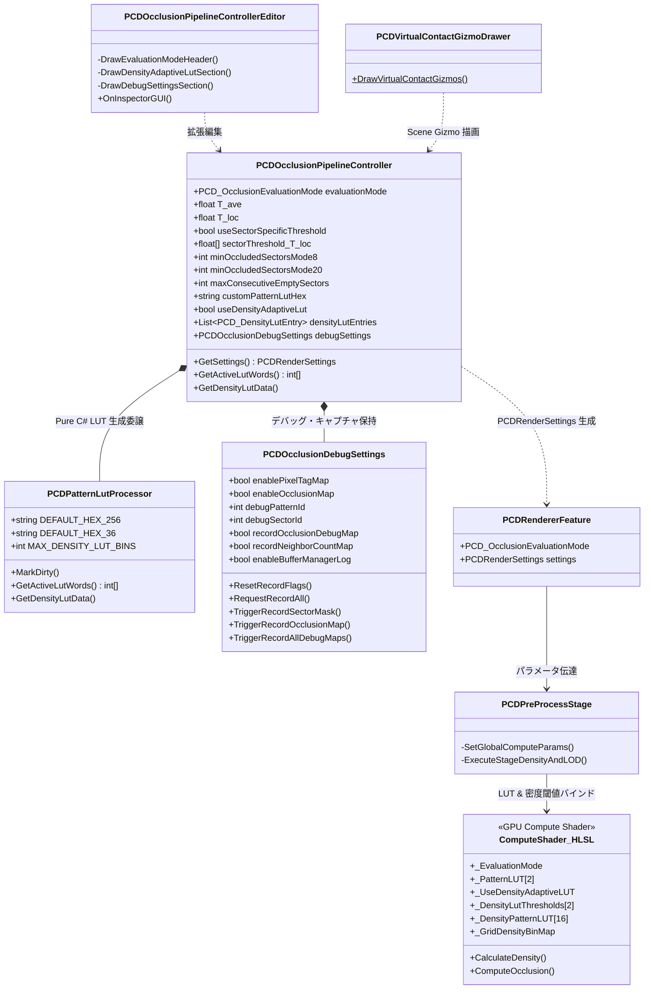
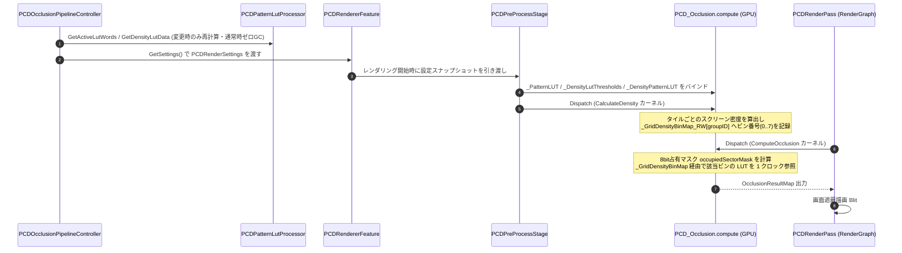

# 視覚オクルージョン・レンダリングシステム 仕様書

> 📂 **親ノード**: [Wiki.md](./Wiki.md) | 🏷️ **種類**: 🏗️ システム設計書  
> [RealTimeOcclusion Wiki (ポータル)](./Wiki.md) に戻る

本ドキュメントは、Intel RealSense 等のセンサーから取得したリアルタイム点群（Point Cloud）を URP RenderGraph パイプライン上でスクリーン空間に精密に投影し、Unity の仮想オブジェクトとの前後遮蔽（オクルージョン）を計算・描画する「視覚オクルージョン・レンダリングシステム」の設計思想、各モジュールの役割、評価モード（Mode 8, 20, 36, 256）、関数構成、および GPU Compute Shader における各種アルゴリズムの詳細を網羅したテクニカルリファレンスです。

---

## 1. 概要

本システムは、実環境からリアルタイムに取得した点群をスクリーン空間に投影し、Unity の仮想 3D 空間に配置されたオブジェクトとの前後関係（オクルージョン）をリアルタイムに計算・遮蔽描画する仕組みです。  
8 セクター方向占有マスクに基づくオクルージョン判定器（Mode 8 / 20 / 36 / 256）を搭載し、**完全最適化済み 256 パターン LUT による 1 クロック高速テーブル参照**、および **タイルごとのスクリーン空間点群密度に応じた動的 LUT 自動切替 (`Density-Adaptive LUT`)** を実現しています。

```text
[統合点群バッファ (_globalBuffer) / 静的メッシュバッファ]
        │ 
        │ (RecordRenderGraph でノンブロッキングにバッファと頂点数を引き渡し)
        ▼
   [PCDRenderPass (URP RenderGraph)]
        │ 
        │ (CalculateDensity でタイル密度ビン _GridDensityBinMap を算出 & LUT バインド)
        ▼
[PCD_Occlusion.compute]
        │ (Mode 8 / 20 / 36 / 256 + 密度別 _DensityPatternLUT 参照 + Hole Filling)
        ▼
  [オクルージョンマップ出力 (画面遮蔽描画)]
```

### 主な特徴

* **4 段階の評価モードと最高精度 Mode 256 (Default)**:
  幾何学的占有パターンに基づく判定方式（Mode 8: 占有数判定、Mode 20: 連続非占有規則、Mode 36: 36 クラス回転不変 LUT、Mode 256: 256 パターン独立最適 LUT）を実装し、実測データで最高性能を達成した **Mode 256 (平均 IoU 96.02%)** を標準採用しています。
* **1 クロック GPU テーブル参照と密度適応型 LUT 自動切替 (`Density-Adaptive LUT`)**:
  256 パターン（256 bit = 32 byte）の判定テーブルを Compute Shader に転送し、ビット演算（シフトと AND）のみの極小負荷で可視・遮蔽を判定します。さらに `useDensityAdaptiveLut` 有効時は、`CalculateDensity` で算出したグリッドセル単位のスクリーン密度に応じて最大 8 段階の LUT（`_DensityPatternLUT[16]`）を 1 クロックのまま動的に切り替え、低密度域の穴埋めと高密度域の過剰遮蔽防止を両立します。
* **責務分離されたモジュラー構成（神クラス解消）**:
  `PCDOcclusionPipelineController` から Pure C# の LUT 生成・キャッシュ処理を `PCDPatternLutProcessor` へ、デバッグ・キャプチャ制御を `PCDOcclusionDebugSettings` へ、Scene ビュー上の HCD 仮想接触 Gizmo 描画を Editor 専用の `PCDVirtualContactGizmoDrawer` へ分離しています。
* **ゼロコピー高効率 GPU パイプライン**:
  CPU-GPU 間のデータ転送オーバーヘッドを排除し、深度情報から頂点バッファへの変換、姿勢変換、およびオクルージョン投影計算までを GPU Compute Buffer 上で一貫処理します。
* **RenderGraph 完全統合**:
  Unity 6 URP RenderGraph アーキテクチャに準拠し、描画パイプラインの途中に非同期オクルージョン計算パスを安全に挿入します。
* **堅牢な Hole Filling アルゴリズム**:
  エッジ保存型 Joint Bilateral フィルタ、およびマルチスケール解像度伝播を行う Pull-Push 法、Opening-Closing モルフォロジー補間を GPU Compute Shader 上に完全実装しています。

---

## 2. 設計思想・アーキテクチャ

### 2.1 ディレクトリ構成

```text
Assets/Features/3DDisplay/
├── ComputeShaders/
│   ├── PCD_Occlusion.compute                 # 統合コンピュートシェーダ エントリポイント
│   ├── PCD_Occlusion_Data.hlsl               # 共通定数・バッファ宣言 (_PatternLUT, _DensityPatternLUT, _GridDensityBinMap 等)
│   ├── PCD_Occlusion_Helpers.hlsl            # ピラミッドダウンサンプル・Sobel 勾配・サンプリング補助関数
│   ├── PCD_Occlusion_Kernels_Preprocess.hlsl # 前処理・投影・Z-Min/密度/密度ビン統合計算カーネル
│   ├── PCD_Occlusion_Kernels_DepthPyramid.hlsl # 深度ピラミッド L1〜L6・勾配補正カーネル
│   ├── PCD_Occlusion_Kernels_Occlusion.hlsl  # オクルージョン判定 (Mode 8/20/36/256, 密度適応LUT, セクター別閾値)
│   ├── PCD_Occlusion_Kernels_FillHoles.hlsl  # ホールフィリング (JointBilateral / Pull-Push / Morphology)
│   └── PCD_Occlusion_Kernels_Post.hlsl       # 仮想深度初期化・補間・デバッグ可視化カーネル
├── Materials/                                # オクルージョン遮蔽合成用マテリアル
└── Scripts/Occlusion/
    ├── Controllers/
    │   ├── PCDOcclusionPipelineController.cs # パイプライン設定管理・シングルトン制御
    │   ├── PCDOcclusionDebugSettings.cs      # デバッグ・キャプチャトリガー集約クラス (責務分離)
    │   ├── PCDSettingsBridge.cs              # 設定ブリッジ・フォールバック仲介
    │   ├── PCDFallbackSettingsFactory.cs     # 不在時フォールバック既定設定・フェード幅クランプ
    │   └── PCDKeyController.cs               # デバッグ表示キー操作コントローラー
    ├── Processors/
    │   └── PCDPatternLutProcessor.cs         # Pure C# LUT 生成・密度LUT量子化・ゼロGCキャッシュ
    ├── Editor/
    │   ├── PCDOcclusionPipelineControllerEditor.cs # カスタムエディタ統括 (Foldout セクション管理)
    │   ├── PCDOcclusionModeHeaderDrawer.cs   # Mode 8/20/36/256 & Density-Adaptive LUT UI 描画
    │   ├── PCDOcclusionDebugSectionDrawer.cs # デバッグ設定・PlayMode キャプチャボタン描画
    │   └── PCDVirtualContactGizmoDrawer.cs   # Editor 専用仮想接触 Gizmo 描画 ([DrawGizmo])
    ├── Passes/
    │   ├── PCDRendererFeature.cs             # URP ScriptableRendererFeature & 設定構造体
    │   └── PCDRenderPass.cs                  # URP RenderGraph パス統括
    ├── Resources/
    │   ├── PCDKernelRegistry.cs              # カーネル ID の初期化・保持
    │   ├── PCDOptionalTexture.cs             # 条件付き RTHandle ラッパー (無効時は 1x1 ダミー確保)
    │   ├── PCDPointBufferManager.cs          # GPU 点群バッファ統合管理
    │   ├── PCDResourcePool.cs                # RTHandle の一元管理 (Alloc / Release)
    │   ├── PCDResourceRequirements.cs        # フレーム単位の動的リソース要求判定
    │   └── PCDShaderConstants.cs             # Shader プロパティ ID 一元定義
    └── Stages/
        ├── PCDPreProcessStage.cs             # パラメータ設定・前処理ステージ
        ├── PCDDepthPyramidStage.cs           # 深度ピラミッド構築・勾配補正ステージ
        ├── PCDOcclusionStage.cs              # オクルージョン判定ステージ
        ├── PCDHoleFillStage.cs               # ホールフィリングステージ
        └── PCDPostProcessStage.cs            # 後処理・デバッグ出力ステージ
```

### 2.2 クラス相関図



### 2.3 処理フロー



---

## 3. セットアップ・使用方法

### 3.1 クイックスタート手順

#### Step 1: URP レンダラーアセット設定

1. Universal Render Pipeline (URP) の Universal Renderer Data アセットを開きます。
2. `Add Renderer Feature` から `PCDRendererFeature` を追加します。

#### Step 2: シーンコントローラー配置とモード選択

1. シーン内の管理用 GameObject に `PCDOcclusionPipelineController` をアタッチします。
2. Inspector 最上部の **「Occlusion Evaluation Mode」** ヘッダーから目的のモード（標準は **Mode 256 ★**）を選択します。

```text
▼ Occlusion Evaluation Mode
   [ Mode 8 (Occ < 7) ]  [ Mode 20 (R=4, L=1) ]  [ Mode 36 (36-LUT) ]  [ Mode 256 ★ (Opt-LUT) ]
```

#### Step 3: パラメータ表

| 設定項目 | 型 | 既定値 | 説明 |
|---|---|---|---|
| `evaluationMode` | `PCD_OcclusionEvaluationMode` | `PatternLUT256` | オクルージョン評価モード（`PatternLUT256`, `RotationLUT36`, `SectorConsecutiveZeros`, `SectorThreshold`, `Average`） |
| `minOccludedSectorsMode8` | `int` | `7` | 【Mode 8 専用】最低占有セクター数 $R_{\mathrm{th}}$（最適値: 7） |
| `minOccludedSectorsMode20` | `int` | `4` | 【Mode 20 専用】最低占有セクター数 $R_{\mathrm{th}}$（最適値: 4） |
| `maxConsecutiveEmptySectors` | `int` | `1` | 【Mode 20 専用】許容最大連続非占有セクター数 $L_{\mathrm{th}}$（最適値: 1） |
| `customPatternLutHex` | `string` | `""` | 【Mode 36 / 256 用】カスタム 64 文字 HEX 文字列（空欄時は最適解を自動適用） |
| `useDensityAdaptiveLut` | `bool` | `false` | 【Mode 36 / 256 用】タイルごとのスクリーン空間点群密度に応じた最適 LUT 自動切替の有効化 |
| `densityLutEntries` | `List<PCD_DensityLutEntry>` | 既定 3 段階 (`0.25 / 1.0 / 4.0+`) | スクリーン密度ビン別 LUT エントリ一覧（最大 `MAX_DENSITY_LUT_BINS = 8` ビン、`maxScreenDensity` 昇順で評価） |
| `minSearchLevel` | `int` | `1` | 近傍探索の最小ピラミッドレベル（0〜6） |
| `enableDensityBasedLOD` | `bool` | `true` | 点群密度に応じた動的 LOD 探索の有効化 |
| `enableGradientCorrection` | `bool` | `true` | 深度急変エッジでのオクルージョン・リーク防止補正 |
| `occlusionThreshold_T_ave` (`T_ave`) | `float` | `0.5f` | Average モード時のオクルージョン判定感度閾値 $T_{\mathrm{ave}}$ |
| `occlusionThreshold_T_loc` (`T_loc`) | `float` | `0.1f` | セクター占有判定（その他全手法）用の局所閾値 $T_{\mathrm{loc}}$ |
| `occlusionFadeWidth` | `float` | `0.1f` | 境界ソフトフェードの減衰幅 |
| `debugSettings` | `PCDOcclusionDebugSettings` | (集約) | デバッグ・キャプチャ用パラメータ（Foldout 折りたたみ表示） |

---

## 4. 仕様・パラメータ詳細

### 4.1 オクルージョン判定モード体系

| モード名 | 列挙値 | 判定原理 | 最適パラメータ / 最良解 HEX | 平均 IoU | 特徴 |
| :--- | :--- | :--- | :--- | :---: | :--- |
| **Mode 256 ★<br/>(Default)** | `PatternLUT256` | 256パターン<br/>完全独立最適LUT | `000BC04F0000018B0003000D8001908D000100010001000080000001D000DD45` | **96.02%** | 全 256 通りの幾何学的占有ビットマスクに対して個別に最適化された最高精度テーブル。可視パターン数: 59 / 256。 |
| **Mode 36** | `RotationLUT36` | 36クラス<br/>幾何学回転不変LUT | `130B008B0000808B000000008000808B5101000100000001D1010001D101D1DF` | **95.98%** | 8セクターの回転対称性を保持した幾何学的同値クラス判定。可視クラス: 13 / 36 クラス（105 パターン）。 |
| **Mode 20** | `SectorConsecutiveZeros` | 連続非占有規則 | 最低占有数 $R_{\mathrm{th}} = 4$,<br/>最大連続非占有 $L_{\mathrm{th}} = 1$ | **95.93%** | 占有数 $N_{\mathrm{occ}} \ge 4$ かつ $L_{\max} \le 1$ で遮蔽。一方向の大きな隙間を許容しない連続性ルール。 |
| **Mode 8** | `SectorThreshold` | 固定8候補<br/>占有数判定 | 最低占有数 $R_{\mathrm{th}} = 7$<br/>($N_{\mathrm{occ}} < 7$ で可視) | **95.92%** | 方向を考慮せず、占有セクター数のみで遮蔽を決定するベースライン手法。 |
| **Legacy Average**| `Average` | 従来平均内積方式 | 内積平均値 $\text{avg} < T_{\mathrm{ave}}$ | — | Bouchiba らの初期手法。全8方向の内積平均値により判定。 |

### 4.2 1 クロック GPU テーブル参照の仕組み

256 パターンの判定結果（可視: `1`, 遮蔽: `0`）は 256 ビット = 32 バイトに収まります。  
`PCDPatternLutProcessor` が C# 側で `int[8]` 配列へ変換して Compute Shader の `uint4 _PatternLUT[2]` に転送し、シェーダ内では以下のビット演算のみで瞬時に評価します。

```hlsl
// occupiedSectorMask: 0..255 (セクター0〜7の占有ビットマスク)
uint wordIdx = (occupiedSectorMask >> 5u) & 7u; // 上位3ビットでワードインデックス (0..7) を取得
uint bitIdx  = occupiedSectorMask & 31u;        // 下位5ビットでビットオフセット (0..31) を取得
uint wordVal = (wordIdx < 4u) ? _PatternLUT[0][wordIdx] : _PatternLUT[1][wordIdx - 4u];
bool isVisible = ((wordVal >> bitIdx) & 1u) != 0u;

alpha = isVisible ? 1.0 : 0.0;
```

分岐命令やループ処理を完全に排除しているため、GPU コアの分岐発散（Warp Divergence）が起きず、極めて高いフレームレートを維持します。

### 4.3 密度適応型 LUT 自動切替 (`Density-Adaptive LUT`)

カメラ距離や対象部位によって画面上の点群占有密度は空間的・時間的に大きく変動します。`useDensityAdaptiveLut`（Mode 36 / Mode 256 有効時）を ON にすると、`CalculateDensity` カーネルで算出した各グリッドセル（`GRID_SIZE × GRID_SIZE`）のスクリーン空間密度に基づき、タイルごとに最適な 256-bit LUT を 1 クロックで切り替えます。

* **条件付きテクスチャ管理 (`PCDOptionalTexture`)**:
  `PCDResourcePool` は `PCDResourceRequirements.DensityAdaptiveLut` が有効な場合のみ、`gridGroupsX × gridGroupsY` サイズの `R8_UInt` テクスチャ `PCD_GridDensityBinMap` を確保します。無効時は 1×1 ダミーテクスチャへ縮退し、VRAM を消費しません。
* **動的 LOD OFF 時の保証**:
  `enableDensityBasedLOD` が `false` であっても、`useDensityAdaptiveLut` が有効かつ有効ビン数が 1 以上であれば、`PCDPreProcessStage` が `CalculateDensity` をディスパッチして `_GridDensityBinMap_RW` を更新します。
* **フォールバック挙動**:
  エントリ内の `patternLutHex` が空欄または不正なビンには、ベース評価モードの LUT（`GetActiveLutWords()`）が自動的にコピーされます。

<details>
<summary><b>📐 密度別 LUT の既定プリセットと GPU 量子化仕様（クリックで展開）</b></summary>

#### 1. 既定の 3 段階密度プリセット (`PCDPatternLutProcessor.CreateDefaultDensityLutEntries`)

| ビン | ラベル | 参照物理密度 (`pts/mm²`) | スクリーン密度上限 (`maxScreenDensity`) | 既定 256-bit LUT HEX (Mode 256) |
| :---: | :--- | :---: | :---: | :--- |
| 0 | `Sparse (0.25 pts/mm²)` | `0.25` | `0.08` | `033B3FAB400380A802008000E0E8808400010101C0008008C0008000C0008001` |
| 1 | `Medium (1.0 pts/mm²)` | `1.0` | `0.28` | `3FFFFFFFCADAFBFBD3B3E29BD709D98BD77FF3FBC0C5F31BD59BDF5FFB97FF7F` |
| 2 | `Dense (4.0+ pts/mm²)` | `4.0` | `1.00` | `7FFFFFFFFFFFFFFFF7BFF3DFFFFBFFFFFFFFFFFFFFF7FFFFFFFFF7FFFFFFFFFF` |

#### 2. 定数バッファパッキングと量子化規則

* **閾値配列**: DX11 の `float[8]` スカラー配列パディングを回避するため、`float4 _DensityLutThresholds[2]` として `Vector4[2]`（計 8 要素）をパック転送します。
* **LUT テーブル**: 最大 `MAX_DENSITY_LUT_BINS = 8` ビン × 256 bit（各ビン `uint4[2]`）を `uint4 _DensityPatternLUT[16]` へ格納します。
* **ビン番号決定 (`CalculateDensity`)**:
  各グリッドセル $g$ のスクリーン密度 $d_g$ に対して、最終ビン $K - 1$ を初期値とし、上位閾値インデックス $i \in \{0, \dots, K-2\}$ を降順走査して $d_g \le \theta_i$ を満たす最小の $i$ を `_GridDensityBinMap_RW[g]` に書き込みます（最終ビンは残り全域を受け持ちます）。

$$
b(g) = \min\Big(\{K - 1\} \cup \{i \in [0, K-2] \mid d_g \le \theta_i\}\Big)
$$

* **`ComputeOcclusion` での参照**:
  `bin = min(_GridDensityBinMap[fullResUV / GRID_SIZE], count - 1)` を取得し、`_DensityPatternLUT[bin * 2 + (wordIdx >= 4 ? 1 : 0)][wordIdx & 3]` から 1 命令で該当ワードを読み出します。

</details>

### 4.4 8 セクター個別二値化閾値 (`Sector-Specific Thresholds`)

手の傾きや RealSense 点群スキャンパターンの幾何学的異方性（水平方向と垂直方向での解像度・点間隔の違い）を補償するため、8 方向のセクター判定それぞれに個別の局所閾値 $T_{\mathrm{loc}}[0..7]$ を適用できる拡張機能を搭載しています。

* **パラメータ**:
  - `useSectorSpecificThreshold` (`bool`): 個別閾値の有効/無効フラグ。
  - `sectorThreshold_T_loc` (`float[8]`): セクター 0〜7 の個別閾値。
* **Compute Shader 定数バインド (`PCDShaderConstants`)**:
  - `_UseSectorSpecificThreshold`: 有効化フラグ (`0` または `1`)。
  - `_SectorThreshold_T_loc_0to3`: セクター 0, 1, 2, 3 の閾値を格納した `float4`。
  - `_SectorThreshold_T_loc_4to7`: セクター 4, 5, 6, 7 の閾値を格納した `float4`。
* **Compute Shader 実装 (`PCD_Occlusion_Kernels_Occlusion.hlsl`)**:
  有効時はセクターインデックスに応じた成分（`_SectorThreshold_T_loc_0to3[i]` または `_SectorThreshold_T_loc_4to7[i-4]`）を局所閾値として動的に参照します。

### 4.5 責務分離モジュール構成（神クラス解消）

`PCDOcclusionPipelineController` が LUT 演算・Gizmo 描画・キャプチャ制御を兼務する神クラス化を防ぐため、以下の責務分離を実施しています。

1. **`PCDPatternLutProcessor` (`Processors/`・Pure C#)**:
   `DEFAULT_HEX_256` / `DEFAULT_HEX_36` 定数、HEX パース、Mode 8 / 20 / 36 / 256 LUT 生成、`GetActiveLutWords()`、および `GetDensityLutData()` のゼロ GC キャッシュ管理を担当します。`PCDOcclusionPipelineController` はシリアライズ設定の保持と薄い委譲のみを行います。
2. **`PCDOcclusionDebugSettings` (`Controllers/`)**:
   常時画面表示フラグ（`enablePixelTagMap`, `enableOcclusionMap`）、デバッグ対象指定（`debugPatternId`, `debugSectorId`）、単フレーム記録フラグ群（`record*`）、およびワンショットキャプチャ呼び出し（`TriggerRecordSectorMask()`, `TriggerRecordOcclusionMap()`, `TriggerRecordAllDebugMaps()`）を一元管理します。
   `PCDOcclusionPipelineController` には後方互換アクセサ（`debugSectorId` 等）を残し、外部スクリプトとの互換性を維持しています。
3. **`PCDVirtualContactGizmoDrawer` (`Editor/`)**:
   `[DrawGizmo]` 属性を用いて Scene ビュー上の `HCD_Pipeline` 追跡クラスタ円盤（`enableVirtualContactOcclusion` 有効時）を描画します。これにより、ランタイムの `PCDOcclusionPipelineController` から `OnDrawGizmos()`・`#if UNITY_EDITOR`・`HCD_Pipeline` への直接依存を完全に排除しています。

### 4.6 GPU パイプライン最適化仕様

リアルタイム 60fps 動作を維持するため、以下の帯域・ディスパッチ削減策をパイプライン全体へ適用しています。

* **Half Float 化による VRAM 帯域削減 (`PCDResourcePool`)**:
  `ViewPositionMap` および `DepthPyramid`（L1〜L6）のテクスチャ形式に `GraphicsFormat.R16G16B16A16_SFloat`（RGBA16F）を採用しています。あわせて、RGBA16F の表現範囲（最大 `65504`）内に安全に収まる共通センチネル定数 `SENTINEL_DEPTH`（`10000.0`）および `SENTINEL_THRESHOLD`（`1000.0`）を `PCD_Occlusion_Data.hlsl` で一元定義しています。
* **グリッド Z-Min・密度算出カーネルの統合 (`CalculateDensity`)**:
  従来別パスで実行していた最小深度算出（旧 `CalculateGridZMin`）と密度・近傍探索レベル・密度ビン算出（`CalculateDensity`）を単一カーネルへ統合しました。同一スレッドグループ内の共有メモリ `shared_z_min` を後続処理で直接参照することで、ディスパッチ 1 回・`_DepthMap` 重複読み取り・中間マップ `GridZMinMap` の確保と読み書きを削減しています。
* **対象外処理の早期除外と遅延ロード**:
  * `PCDRendererFeature.AddRenderPasses`: 対象外カメラを `GetSettings()` 呼び出し前に `cameraTargetMode` / `cameraNameFilter` で早期除外します。
  * `ZMinPhysicalDownsample`: `_EnableTagBasedOptimization > 0` の場合、先に軽量な `_OriginTypeMap`（`R8_UInt`）のみを確認し、物理点群（`0u`）が存在するピクセルのみ `_ViewPositionMap` を読み取ります。
  * `SobelOnPyramidSq`: ソーベル勾配の平方根（`sqrt`）計算を省略し、二乗閾値（`_GradientThreshold_g_th` の二乗）と比較します。
  * `ComputeOcclusion`: タグベース最適化による早期 `return` の後に `_ViewPositionMap` 読み取りを配置し、物理点群・背景ピクセルでの不要なフェッチを回避します。
  * `ClearCounter` / `RequestStaticMeshCounterReadback`: 仮想深度統合（`runInitFromCamera`）が有効なフレームのみ実行します。

---

## 5. デバッグ・留意事項

### 5.1 画面表示デバッグ & キャプチャ機能

Inspector 最下部の **「🛠️ Debug & Record Settings」** を開くことで、多彩なデバッグ表示とデータエクスポートが可能です。

* **セクターマスク表示 (`debugSectorId`)**:
  - `-1`: 通常オクルージョン描画
  - `0..7`: 個別セクター（セクター 0〜7）の単独二値マスク表示
  - `8`: 全 8 セクター統合の 8bit グレースケールマスク表示（占有パターン 0〜255 を可視化）
  - `9`: GPU 真値マスク表示
* **クイックキャプチャボタン (PlayMode 専用)**:
  - `PCDOcclusionPipelineControllerEditor` から `controller.debugSettings` の `TriggerRecordSectorMask()`, `TriggerRecordOcclusionMap()`, `TriggerRecordAllDebugMaps()` を呼び出します。
  - `📸 占有セクターマスク (SectorMask RAW/CSV/PNG) を出力`: 1 フレームの占有セクターマスクを `Assets/HandTrackingData/SectorMasks/` に自動保存します。
  - `📸 オクルージョンマップ (OcclusionMap PNG/CSV) を出力`: 遮蔽スコアマップを出力します。
  - `📸 全デバッグマップ 一括出力`: 全種類のマップを同一フレームで一括記録します。
* **密度別 LUT & 仮想接触 Gizmo の確認**:
  - `PatternLUT256` / `RotationLUT36` 選択時は Inspector 上に `Density-Adaptive LUT (密度別最適LUT)` セクションが表示され、`densityLutEntries` の編集および既定 3 段階設定へのリセットが可能です（`8` 件超過時は先頭 8 件のみ GPU へ転送される旨の警告を表示します）。
  - Scene ビューの仮想接触円盤 Gizmo は `PCDVirtualContactGizmoDrawer` (`[DrawGizmo]`) が `enableVirtualContactOcclusion && Application.isPlaying` 時に描画します。

### 5.2 統制ログシステム (`AppLogManager`) との同期

オクルージョンパイプラインのログ出力は、`AppLogger` および `AppLogManager` により統制管理されます。

* `[PCD_Pipeline]`: パイプライン制御、モード切替、解像度変更イベント
* `[PCD_BufferManager]`: 点群バッファ更新 (`enableBufferManagerLog`)
* `[PCD_ContextBuilder]`: 事前計算コンテキスト、カメラ行列検証、ピクセル数集計
* `[PCD_RecordDebug]`: GPU テクスチャ AsyncReadback 完了通知
* `[PCD_Exporter]`: PNG/CSV ファイル保存完了通知

統制ログ仕様の詳細については [Logging.md](./Logging.md) を参照してください。
