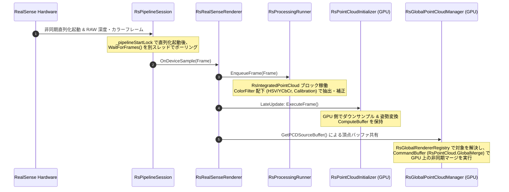

# 点群ストリーミング・統合パイプライン 仕様書

> 📂 **親ノード**: [Wiki.md](./Wiki.md) | 🏷️ **種類**: 🏗️ システム設計書  
> [RealTimeOcclusion Wiki (ポータル)](./Wiki.md) に戻る

本ドキュメントは、Intel RealSense 等のセンサーから取得したリアルタイム点群（Point Cloud）を CPU/GPU で効率よくストリーミング・フィルタリングし、複数の点群を非同期でマージする「点群ストリーミング・統合パイプライン」の設計思想、モジュール構成、データフロー、パラメータ詳細およびデバッグ手順について解説します。

視覚オクルージョンの描画パスについては [OcclusionRendering.md](./OcclusionRendering.md) を参照してください。

---

## 1. 概要

本パイプラインは、実機センサー（RealSense）やデバッグシステムからフレームをリアルタイムに取得し、CPU メインスレッドの負荷を極小化しながら GPU 上でノイズ除去・アライメント補正・複数センサ統合マージを一貫して行うデータストリーミングアーキテクチャです。

### 主な特徴

* **統合コンポーネント (`RsRealSenseRenderer`) による単一窓口化**: `RsDevice`・`RsProcessingPipe`・`RsPointCloudRenderer` の3コンポーネントを1つに統合した `RsRealSenseRenderer` を提供します。従来の3コンポーネント構成とも `IRsFrameSource` および `IRsProcessIntervalConfigurable` を介して後方互換を維持しています。
* **非同期起動 & スレッドフレームキャプチャ**: ネイティブ `Pipeline` 管理を `RsPipelineSession`、パス解決・録画検証を `RsDevicePathResolver`、リトライ付き起動制御を `RsPipelineStartHelper` へ分離しています。バックグラウンドでの直列化起動（`_pipelineStartLock`）によりメインスレッドをブロックせず、Worker Thread において `WaitForFrames()` を非同期ポーリングして 10 回連続エラー検出時に安全停止します。
* **ColorFilter によるインライン事前処理**: `RsColorBasedDepthCulling` (HSV/YCbCr 色閾値カリング) および `RsDepthToColorCalibration` (キャリブレーション姿勢アライメント補正) により、腕や背景の不要点群を早期除去します。
* **GPU Direct モード & 帯域削減**: `RsProcessingRunner` および `RsPointCloudInitializer` によるゼロコピー GPU 転送と、`YUYV` 16bit カラーフォーマットによる転送帯域幅 33% 削減を実現しています。
* **非同期 CommandBuffer マージ**: `RsGlobalPointCloudManager` と `RsGlobalRendererRegistry` が `Graphics.ExecuteCommandBuffer` 経由で `"RsPointCloud.GlobalMerge"` を発行し、CPU をブロックせずに複数点群バッファ (`_globalBuffer`) を GPU 上で非同期統合します。

---

## 2. 設計思想・アーキテクチャ

### 2.1 生成ファイル・ディレクトリ構成

```text
Assets/Features/RealSense/
├── Editor/
│   ├── RsGeneralControllerEditor.cs   # 親オブジェクト統合タブ Inspector
│   ├── RsGlobalTabDrawer.cs           # Global タブ & スキャン範囲 Scene ギズモ描画
│   ├── RsTransformTabDrawer.cs        # Transform タブ描画
│   ├── RsRealSenseRendererEditor.cs   # 実機統合コンポーネント用カスタム Inspector
│   └── RsDummyRealSenseRendererEditor.cs # Dummy 統合コンポーネント用カスタム Inspector
└── Scripts/
    ├── IRsFrameSource.cs              # フレームストリーム共通インターフェース
    ├── IRsProcessIntervalConfigurable.cs # 間引き間隔設定インターフェース
    ├── RsGeneralController.cs         # 親管理コンポーネント統合ハブ
    ├── RsProcessingPipe.cs            # レガシー互換パイプラインファサード
    ├── RsProcessingRunner.cs          # ブロック処理・間引き・メモリ管理 (Pure C#)
    ├── Device/
    │   ├── RsDevice.cs                # RealSense ライフサイクル・イベント公開ファサード
    │   ├── RsPipelineSession.cs       # ネイティブ Pipeline 直列化非同期起動 & ポーリング
    │   ├── RsPipelineStartHelper.cs   # 起動リクエスト構築 & リトライ制御ヘルパー
    │   └── RsDevicePathResolver.cs    # 再生/録画パス解決 & 録画ファイル検証
    ├── PointCloud/
    │   ├── RsRealSenseRenderer.cs     # デバイス・パイプライン・描画統合コンポーネント
    │   ├── RsPointCloudRenderer.cs    # 点群レンダリング基底・公開 API 窓口
    │   ├── RsPointCloudInitializer.cs # GPU Direct / DataProvider 初期化 & フレーム実行
    │   ├── RsGlobalPointCloudManager.cs # 全点群バッファの GPU 非同期マージ統括
    │   └── RsGlobalRendererRegistry.cs # レンダラー収集・キャッシュ・一括操作
    └── ProcessingBlocks/ColorFilter/
        ├── RsColorBasedDepthCulling.cs # HSV / YCbCr 色空間背景カリング
        ├── RsDepthToColorCalibration.cs # カメラ内外参再投影補正
        ├── RsIntegratedPointCloud.cs  # GPU Direct Mode 統合点群ブロック
        └── RsIntegratedPointCloudProcessor.cs # ComputeShader 転送・非同期リードバック
```

### 2.2 クラス相関図



### 2.3 処理・データ転送フロー

```text
[RealSense カメラ / 再生ファイル]
        │ 
        │ (非同期 Worker Thread フレームキャプチャ)
        ▼
[RsRealSenseRenderer] (内部: RsPipelineSession + RsProcessingRunner)
        │ 
        │ (RsIntegratedPointCloud フィルタパイプライン / ColorFilter)
        │ ├─ RsColorBasedDepthCulling (HSV/YCbCr 色閾値カリング)
        │ ├─ RsDepthToColorCalibration (幾何アライメント補正)
        │ └─ RsUnityMainThreadDispatcher (スレッド安全転送)
        ▼
[RsPointCloudInitializer] (GPU Direct Mode / ComputeBuffer 共有)
        │
        ▼ (GetPCDSourceBuffer() による個別頂点バッファ共有)
[RsGlobalPointCloudManager] (RsGlobalRendererRegistry)
        │ 
        │ (★ CommandBuffer "RsPointCloud.GlobalMerge" 構築)
        │ (★ Graphics.ExecuteCommandBuffer により GPU 上で非同期マージ)
        ▼ 
[_globalBuffer へのマージ完了 (以降の RenderGraph オクルージョンパスへ)]
```

---

## 3. セットアップ・使用方法

### 3.1 クイックスタート手順

#### Step 1: シーンオブジェクト配置

1. シーン内の `RealSense` 親オブジェクト（`RsGeneralController`・`RsDeviceController`・`RsGlobalPointCloudManager`・`RsMaterialController`・`RsTransformController`・`RsPointCloudCapturer` を配置）の直下に、カメラごとの子オブジェクトを作成し、`RsRealSenseRenderer` をアタッチします。
2. `RsGeneralController` の Inspector 上部タブ（`Global` / `Device` / `Transform` / `Material` / `Capture`）から全体設定を一元管理し、各子オブジェクトの `RsRealSenseRenderer` 上で `DeviceConfiguration`（シリアル番号・解像度・FPS）と `processingProfile` を設定します。

#### Step 2: インスペクターパラメータ設定

| 設定項目 | 型 | 既定値 | 説明 |
|---|---|---|---|
| `mode` | `WorkerMode` | `Multithread` | フレームキャプチャの実行モード (`Multithread` / `UnityThread`) |
| `maxConsecutiveErrors` | `int` | `10` | 連続エラー検出時の自動停止閾値 |
| `maxPointCount` | `int` | `3000000` | `RsGlobalPointCloudManager` の最大統合点群数上限 |
| `enableColorCulling` | `bool` | `true` | HSV/YCbCr 色空間による不要領域カリングの有効化 |

#### Step 3: 実行と動作確認

1. Play モードに入ると、`RsRealSenseRenderer`（または `RsDevice`）が自動的に RealSense ハードウェアを検出・ストリーミングを開始します。
2. マージされた点群データは `RsGlobalPointCloudManager._globalBuffer` に格納され、URP レンダラーパスへ引き渡されます。

---

## 4. 仕様・パラメータ詳細

### 4.1 RealSense ストリーミングパイプライン仕様

#### A. 統合コンポーネントと責務分離 (`RsRealSenseRenderer.cs` / `RsPipelineSession.cs` / `RsProcessingRunner.cs`)
* `RsRealSenseRenderer.cs`（統合 MonoBehaviour ファサード）: `RsPointCloudRenderer` を継承しつつ、デバイス設定 (`DeviceConfiguration`)・パイプラインプロファイル (`processingProfile`)・点群描画設定を単一コンポーネントへ集約します。
* `RsPipelineSession.cs`（純粋 C# `IDisposable`）: ネイティブ `Pipeline` と `PipelineProfile` を保持し、`Task.Run` と `_pipelineStartLock` によるバックグラウンド直列化起動、Worker Thread での `WaitForFrames()` ポーリング（`Multithread` モード）、`Update()` からの `PollFrames()`（`UnityThread` モード）、および `Dispose()` 時のリソース解放を担当します。
* `RsPipelineStartHelper.cs`（純粋 C# static ヘルパー）: `RsDevice` と `RsRealSenseRenderer` に共通する起動リクエスト構築およびリトライ付き非同期起動制御を担当します。
* `RsDevicePathResolver.cs`（純粋 C# static ヘルパー）: `ResolveAbsolutePath` による再生・録画パス解決、保存先ディレクトリ生成（`EnsureRecordDirectory`）、および録画ファイル検証（`VerifyRecordedFile`）を担当します。
* **エラーリカバリ機能**: 連続 10 回のエラー検出（`maxConsecutiveErrors = 10`）で安全にストリーミングを自動停止します。

#### B. パイプライン実行とネイティブメモリ管理 (`RsProcessingRunner.cs` / `RsProcessingPipe.cs`)
* `RsProcessingRunner.cs` が `RsProcessingProfile` のランタイム複製・破棄、`CustomProcessingBlock` のライフサイクル、フレーム間引き、およびキャリブレーション設定を純粋 C# として管理します。
* RealSense SDK のネイティブ `Frame` インスタンスは、`using` ステートメントおよび `try-finally` 節で毎フレーム確実に Dispose 処理され、アンマネージドメモリリークを抑止します。

#### C. `RsIntegratedPointCloud` (GPU Direct Mode)
* `RsPointCloudInitializer.cs` で初期化時に自動検出され「GPU Direct Mode」へ移行します。
* キャリブレーション姿勢変換行列 (`Matrix4x4`) を毎フレーム Compute Shader へバインド更新します。
* `YUYV` (16bit) カラーフォーマットのサポートにより、USB / PCIe 転送帯域幅を 33% 削減します。

#### D. `ColorFilter` 事前処理モジュール
* `RsColorBasedDepthCulling.cs`: HSV / YCbCr 色空間閾値判定により、人物の腕や背景の不要点群を早期カリングします。
* `RsDepthToColorCalibration.cs`: カメラ内部・外部パラメータを用いて 3D 逆射影・再投影位置補正を実行します。

---

## 5. デバッグ・留意事項

### 5.1 非同期点群マージ (`RsGlobalPointCloudManager`)

* `_globalBuffer` (最大 300 万点) への統合マージは、再利用可能な `CommandBuffer` (`"RsPointCloud.GlobalMerge"`) に全レンダラー分のディスパッチを記録し、1 回の `Graphics.ExecuteCommandBuffer` により GPU キューへ投入されます。HCD 接触判定およびオクルージョン描画の双方で `_globalBuffer` を共有し、重複マージを排除しています。
* **自動レンダラー探索とキャッシュ (`RsGlobalRendererRegistry`)**: `renderers` リストや直下階層にレンダラーが見つからない場合、30 フレーム間隔のシーン全体探索キャッシュによって負荷を抑えつつ、全 `RsPointCloudRenderer` / `RsRealSenseRenderer` / `RsDummyRealSenseRenderer` を自動検出・統合します。
* **PCD パイプライン自動連携**: マージ完了後、`PCDContextBuilder` が `RsGlobalPointCloudManager.Instance` の存在を安全に検出し、オクルージョン計算パスへ自動的に `GetOcclusionGlobalBuffer()` を `SetExternalBuffer` 経由で供給します。

### 5.2 統制ログシステム (AppLogManager) との同期

本モジュールの動作ログには、プレフィックス `[PointCloudPipeline]` が付加され、`AppLogManager` 上で制御されます。

* `[PointCloudPipeline] RsDevice: RealSense ストリーミングを開始しました。`
* `[PointCloudPipeline] RsGlobalPointCloudManager: _globalBuffer (点数: ...) への非同期マージ完了`

詳細な共通ログルールについては [Logging.md](./Logging.md) を参照してください。
