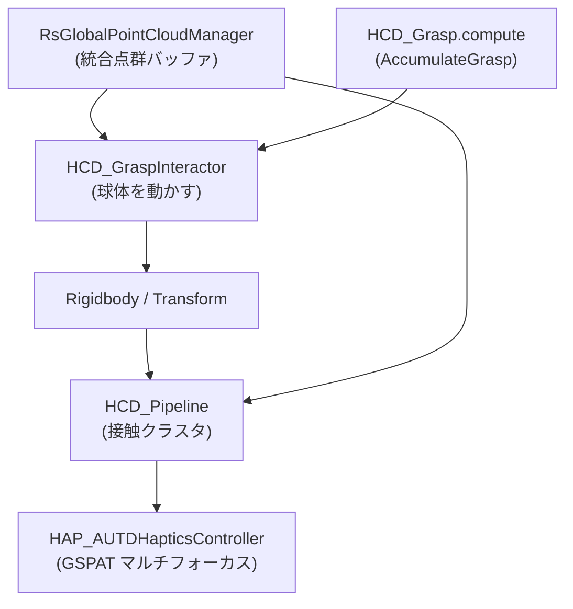

# 球体の握り込み・押し・転がし (HCD_GraspInteractor) 仕様書

> 📂 **親ノード**: [PhysicalResponse.md](./PhysicalResponse.md) | 🏷️ **種類**: ⚙️ 機能  
> [RealTimeOcclusion Wiki (ポータル)](./Wiki.md) に戻る  
> 📎 **関連ドキュメント**: [Collision.md](./Collision.md) | [Haptics.md](./Haptics.md)

本ドキュメントでは、手の点群で仮想の球体を握り込む・指で押す・離して転がす操作を実現する `HCD_GraspInteractor` の設計、使用手順、パラメータ、デバッグ方法について解説します。触覚の提示は既存の `HCD_Pipeline` と `HAP_AUTDHapticsController` が担当し、本コンポーネントは球体の動きだけを担当します。

---

## 1. 概要

統合点群バッファ (`RsGlobalPointCloudManager`) のうち、球体の周囲にある点群を Compute Shader で集計し、握り込みの有無と手の移動量を推定して球体を動かします。

### 主な特徴

* **握り込み判定**: 接触点数、手に覆われた方向の数、接触方向の偏りの 3 条件で判定します。手のひらを当てただけでは握り込みになりません。
* **手への追従**: 握っている間、球体の周囲にある点群の重心の移動量に合わせて球体を移動します。
* **指で押す**: 握っていないとき、点群が球体にめり込んだ分だけ球体を押し出します。
* **物理による転がり**: `Rigidbody` と床のコライダーがあれば、離したときや押したときに転がります。
* **GPU 集計**: CPU に読み戻すのは約 48 個の整数のみです。点群そのものは読み戻しません。

---

## 2. 設計思想・アーキテクチャ

### 2.1 生成ファイル・ディレクトリ構成

```text
Assets/Features/HapticsCollision/
├── ComputeShaders/
│   └── HCD_Grasp.compute            # AccumulateGrasp カーネル (点群の集計)
└── Scripts/
    └── Interaction/
        └── HCD_GraspInteractor.cs   # 握り込み判定・追従・押し出し・物理制御
```

### 2.2 クラス相関図



### 2.3 処理フロー

1. 毎フレーム、球体の中心を基準に `AccumulateGrasp` を実行します。
2. 次の 3 つの領域で点群を集計します。

| 領域 | 半径 | 用途 |
|:---|:---|:---|
| 押し出し領域 | 球の半径 + `Push Margin` | めり込み量の集計 (押す) |
| 接触殻 | 球の半径 + `Grab Margin` | 握り込み判定 |
| 追従領域 | 球の半径 + `Track Margin` | 手の移動量の推定 (重心) |

3. 握り込み条件を満たすと握り状態に入り、球体を手の重心に追従させます。握っている間は `Rigidbody` が Kinematic になります。
4. 握っていないときは、押し出し量だけ球体を動かし、物理が有効なら押した方向に速度を与えます。
5. 球体が動くと、`HCD_Pipeline` が球体メッシュとの接触を検出し、既存の触覚出力が更新されます。

---

## 3. セットアップ・使用方法

### 3.1 クイックスタート手順

#### Step 1: コンポーネントの追加

球体の GameObject に `HCD_GraspInteractor` を追加し、`Grasp Compute Shader` に `HCD_Grasp.compute` を設定します。

#### Step 2: 物理設定 (転がす場合)

`HCD_GraspInteractor` のコンテキストメニューから **Setup Physics (Rigidbody + SphereCollider + Floor)** を実行します。`Rigidbody`、`SphereCollider`、球体の真下の床 (`HapFloor`、非表示) が作成されます。床の位置と大きさは、手の動作範囲に合わせて調整します。

#### Step 3: 触覚の設定

`HCD_Pipeline` の `Distance Processor` で、球体の `MeshFilter` を接触判定の対象に設定します。設定方法は [Collision.md](./Collision.md) を参照してください。

### 3.2 主要パラメータ

| 設定項目 | 説明 |
|:---|:---|
| `Grab Min Points` | 握り込みとみなす接触殻内の最小点数 |
| `Grab Min Bins` | 手に覆われている必要がある方向 (8 分割中) の数 |
| `Grab Max Direction Bias` | 接触方向の偏りの上限 (0: 均等、1: 一方向) |
| `Enable Push` | 指で押す機能の有効化 |
| `Use Physics` | `Rigidbody` による物理制御の有効化 |

---

## 4. 仕様・パラメータ詳細

### 4.1 パラメータ・API詳細

| パラメータ | 型 | 既定値 | 説明 |
|:---|:---|:---|:---|
| `Auto Sphere Radius` | bool | `true` | `SphereCollider` または `Renderer` から半径を求めます |
| `Sphere Radius` | float | `0.05` | 半径 (m)。`Auto Sphere Radius` が無効のときに使用します |
| `Grab Margin` | float | `0.02` | 接触殻の厚み (m) |
| `Track Margin` | float | `0.06` | 追従領域の厚み (m) |
| `Grab Min Points` | int | `200` | 握り込みの最小接触点数 |
| `Min Points Per Bin` | int | `20` | 方向を「覆われた」とみなす最小点数 |
| `Grab Min Bins` | int | `3` | 覆われている必要がある方向の数 |
| `Grab Max Direction Bias` | float | `0.75` | 方向の偏りの上限 |
| `Release Hysteresis` | float | `0.5` | 握っている間の解除側しきい値の緩さ |
| `Release Delay` | float | `0.15` | 条件を外れてから離すまでの猶予 (s) |
| `Push Margin` | float | `0.005` | 球の表面より手前から押し始める距離 (m) |
| `Push Min Points` | int | `5` | 押し出しに必要な最小点数 |
| `Push Dead Zone` | float | `0.001` | 押し出し量の無視しきい値 (m) |
| `Push Gain` | float | `1.0` | 押し出し量の倍率 |
| `Max Push Per Frame` | float | `0.03` | 1 フレームの最大押し出し量 (m) |
| `Follow Smooth Time` | float | `0.04` | 追従の平滑化時間 (s) |
| `Max Follow Speed` | float | `3.0` | 追従の最大速度 (m/s) |

公開プロパティは、`IsGrasped` (握り込み中か)、`ContactPointCount` (接触殻内の点数)、`DirectionBias` (接触方向の偏り) です。

### 4.2 数式モデル・理論的背景 (折りたたみ形式)

<details>
<summary>方向の偏りと押し出し量の定義</summary>

接触殻内の点 $p_i$ と球体中心 $c$ から、単位方向ベクトルを $n_i = (p_i - c) / \lVert p_i - c \rVert$ とします。接触点数を $N$ とすると、方向の偏り $b$ は次式です。

$$ b = \frac{\left\lVert \sum_i n_i \right\rVert}{N} $$

手のひらを当てただけの状態では $b$ が 1 に近く、球体を囲んだ状態では小さくなります。

押し出し領域 (半径 $R_p$) 内の各点のめり込み量は、$d_i = \lVert p_i - c \rVert$ として次式です。

$$ \Delta = \frac{1}{M} \sum_{i} \left( -n_i \right) \left( R_p - d_i \right) \cdot g $$

$M$ は押し出し領域内の点数、$g$ は `Push Gain` です。

</details>

---

## 5. デバッグ・留意事項

### 5.1 Play モード時の確認

Inspector の `Debug Status` に、握り込み状態、接触点数、方向の偏りが表示されます。シーンビューでは、接触殻の半径が球のワイヤーで表示されます。握り込み中は橙色です。

### 5.2 判定が合わない場合

| 症状 | 調整する項目 |
|:---|:---|
| 握っても反応しない | `Grab Min Bins` を下げる、`Grab Min Points` を下げる、`Grab Max Direction Bias` を上げる |
| 手を当てただけで握りになる | `Grab Max Direction Bias` を下げる、`Grab Min Bins` を上げる |
| 球が震える | `Push Dead Zone` を上げる |
| 指が球にめり込む | `Push Gain` を上げる |

### 5.3 留意事項

* RealSense は片側からしか見えないため、手の反対側の点群は得られません。覆われた方向の数が不足しやすい点に注意してください。
* 握っている間の `Rigidbody` は Kinematic です。握ったまま床の下へ移動すると、床をすり抜けます。
* `HCD_Grasp.compute` の構造体は、`RsGlobalPointCloudManager` の `STRIDE` (28 bytes) と一致させる必要があります。

### 5.4 統制ログシステム (AppLogManager) との同期

* グループ名: `HCD (Haptic Collision)`
* サブトリガータグ: `HCD_GraspInteractor` (Compute Shader 未設定などのエラー、Setup Physics の完了ログ)
